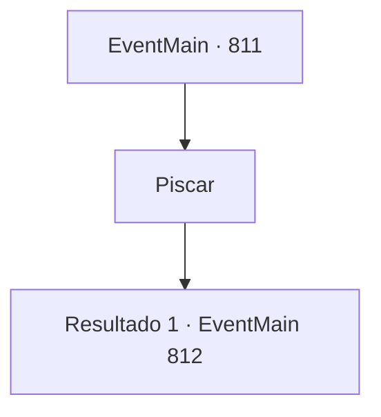

# Eventos principais · 811

[Índice da tabela](index.md) · [Índice geral](../index.md)

ID: `pt:EventMain:811` · Fonte: `EventMain4` · Versão: 1.2.47.

Mapeamento estático dos arquivos; a disponibilidade e a execução dependem do estado da run.

## Texto do evento

*Sem texto no arquivo.*

## Dados de entrada

```json
{
  "id": 811,
  "grade": 1,
  "normalGoal": "",
  "required": ""
}
```

## Mapa das escolhas



## Escolhas e resultados

### Escolha 1

Piscar

Requisitos e outros campos da escolha:

```json
{
  "required": ""
}
```

#### Resultado 1.1

|drawing_sittingKior| Quando você abre os olhos novamente, você vê um vasto palácio. É pelo menos cinco vezes maior e mais alto do que a Catedral de Teretian. Não apenas a largura e altura do prédio, mas tudo nele é enorme. E no trono no final do salão está Kior. Ele é o mesmo que quando eu te conheci, mas ele é enorme. Seus ossos da canela são mais altos do que você. Seus olhos vermelhos sangue olham para baixo para os paladinos. 

 "Bom trabalho. {1}. Danica. Eu vou te recompensar por cumprir fielmente as minhas ordens."

 Quando ele termina de falar, muitos demônios aparecem na escuridão. Os demônios cercam os paladinos e os atacam, e o palácio rapidamente se torna um campo de batalha. Kior aponta para Onil, que luta contra os demônios com todas as suas forças, e diz para você. 

 "Agora, vou te dar uma chance de matar Onil primeiro. {1}."


Continuação registrada: [Evento 812](0812.md) na mesma tabela.

```json
{
  "required": "",
  "chance": "1",
  "nextEvent": 812,
  "type": 2,
  "reward": "6_0_145",
  "place": 7
}
```

## Referências que chegam a este evento

- [Evento 820 · escolha 1 · resultado 1](0820.md#escolha-1)
