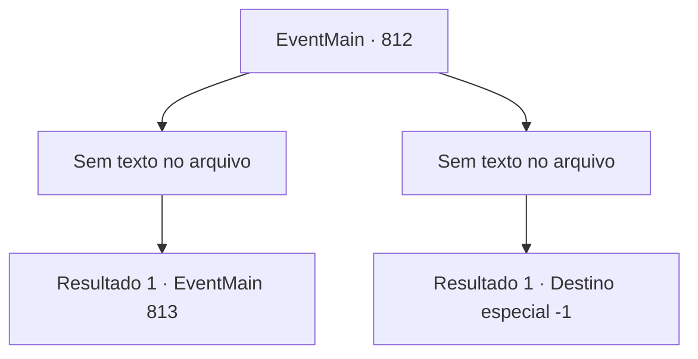

# Eventos principais · 812

[Índice da tabela](index.md) · [Índice geral](../index.md)

ID: `pt:EventMain:812` · Fonte: `EventMain4` · Versão: 1.2.47.

Mapeamento estático dos arquivos; a disponibilidade e a execução dependem do estado da run.

## Texto do evento

*Sem texto no arquivo.*

## Dados de entrada

```json
{
  "id": 812,
  "grade": 1,
  "normalGoal": "",
  "required": ""
}
```

## Mapa das escolhas



## Escolhas e resultados

### Escolha 1

*Sem texto no arquivo; o papel dessa opção depende da interface do jogo.*

Requisitos e outros campos da escolha:

```json
{
  "required": ""
}
```

#### Resultado 1.1

Você chuta a cabeça torcida de Onil e olha ao redor. Os Paladinos estão lutando contra os Demônios, mas talvez por causa do cerco, seu dano é mais significativo. Nesse momento, Publius começa a gritar feitiços com as mãos juntas. 

 "Oh, Grande Tere! A vida desse cordeiro é sacrificada! Por favor, faça um milagre pela luz!"

 O espaço é distorcido pela voz de Publius. Há um enorme buraco no ar; dentro, você vê a figura da Catedral de Yerut. Quando você vê isso, Valen grita. 

 "O arcebispo fez um milagre! Protejam o Arcebispo!"

 Milagre, ela disse, significava que apenas grandes sacerdotes dariam suas vidas para exercer o poder de Deus. Em outras palavras, Publius sacrificou sua vida e abriu o portal. 

 "Isso é bom! Matem o Publius. {1}."

 Na voz de Kior, você olha para Publius. Os ataques dos demônios estão se intensificando em Publius.

Continuação registrada: [Evento 813](0813.md) na mesma tabela.

```json
{
  "required": "",
  "chance": "1",
  "nextEvent": 813,
  "type": 2,
  "reward": ""
}
```

### Escolha 2

*Sem texto no arquivo; o papel dessa opção depende da interface do jogo.*

Requisitos e outros campos da escolha:

```json
{
  "required": ""
}
```

#### Resultado 2.1

Sua cabeça é cortada pela espada de Onil. Você grita para Kior, sentindo o mundo girar. Por favor, me ajude. Farei qualquer coisa. Por favor, me ajude. Mas sua voz não sai da sua boca. Em vez disso, você ouve a voz de um Kior que chuta a língua. 

 "Desculpe. {1}. Não se preocupe. Usarei suas almas, assim como as deles."

 Vem um sono profundo em que você não consegue pensar no que as palavras de Kior significam.

Continuação registrada: [Destino especial `-1`](../destinos-especiais.md).

```json
{
  "required": "",
  "chance": "1",
  "nextEvent": -1,
  "type": 2,
  "reward": "15_5_40|15_5_14|15_5_33"
}
```

## Referências que chegam a este evento

- [Evento 811 · escolha 1 · resultado 1](0811.md#escolha-1)
