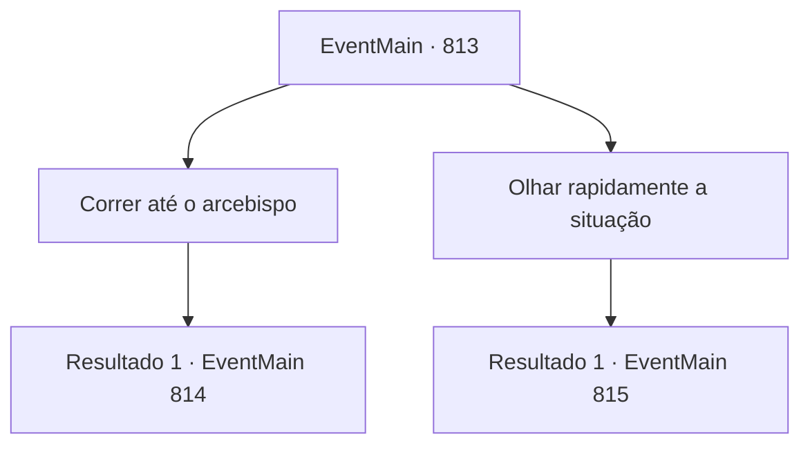

# Eventos principais · 813

[Índice da tabela](index.md) · [Índice geral](../index.md)

ID: `pt:EventMain:813` · Fonte: `EventMain4` · Versão: 1.2.47.

Mapeamento estático dos arquivos; a disponibilidade e a execução dependem do estado da run.

## Texto do evento

*Sem texto no arquivo.*

## Dados de entrada

```json
{
  "id": 813,
  "grade": 1,
  "normalGoal": "",
  "required": ""
}
```

## Mapa das escolhas



## Escolhas e resultados

### Escolha 1

Correr até o arcebispo

Requisitos e outros campos da escolha:

```json
{
  "required": ""
}
```

#### Resultado 1.1

Agora que ele está realizando milagres, Publius está indefeso. Você passa pelos paladinos lutando contra os demônios e empunha sua arma contra Publius. Sem responder, Publius se endurece.

 'Clink!'

 Mas sua espada não toca o pescoço de Publius. 

 "Se você quer ferir o arcebispo, derrube-me primeiro!"

 A espada de Valen voa em sua direção num piscar de olhos.

Continuação registrada: [Evento 814](0814.md) na mesma tabela.

```json
{
  "required": "",
  "chance": "1",
  "nextEvent": 814,
  "type": 2,
  "reward": "6_0_148",
  "place": 7
}
```

### Escolha 2

Olhar rapidamente a situação

Requisitos e outros campos da escolha:

```json
{
  "required": ""
}
```

#### Resultado 2.1

Você observa a situação por um momento. Agora que ele está realizando milagres, Publius está indefeso. Mas, como os paladinos estão o protegendo, é difícil atacar. Você está procurando um momento em que todos os paladinos estejam focados no combate. 

 "Se você quer prejudicar o arcebispo, me derrube primeiro!"

 Você não se move até ver Valen, o melhor paladino do teretiano, correndo em direção a Balor. Você passa pelos paladinos lutando contra os demônios e empunha sua arma contra Publius. 

 "Ack, oh... meu..."

 Quando você se aproxima, Publius interrompe o milagre e evita o ataque. Logo, uma lança de luz de sua mão voa em sua direção.

Continuação registrada: [Evento 815](0815.md) na mesma tabela.

```json
{
  "required": "",
  "chance": "1",
  "nextEvent": 815,
  "type": 2,
  "reward": "6_0_151",
  "place": 7
}
```

## Referências que chegam a este evento

- [Evento 812 · escolha 1 · resultado 1](0812.md#escolha-1)
