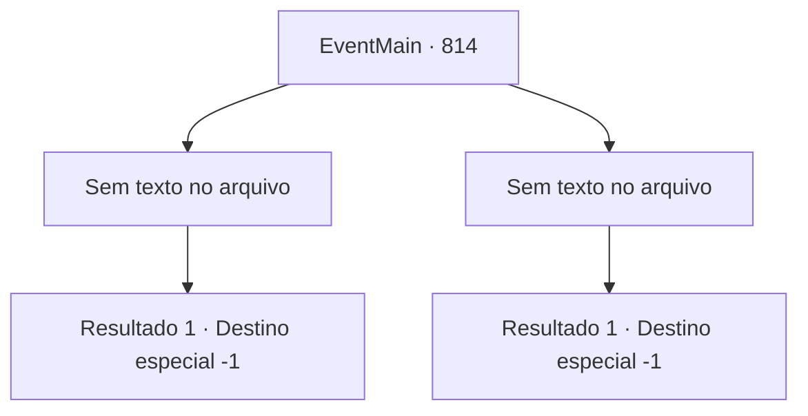

# Eventos principais · 814

[Índice da tabela](index.md) · [Índice geral](../index.md)

ID: `pt:EventMain:814` · Fonte: `EventMain4` · Versão: 1.2.47.

Mapeamento estático dos arquivos; a disponibilidade e a execução dependem do estado da run.

## Texto do evento

*Sem texto no arquivo.*

## Dados de entrada

```json
{
  "id": 814,
  "grade": 1,
  "normalGoal": "",
  "required": ""
}
```

## Mapa das escolhas



## Escolhas e resultados

### Escolha 1

*Sem texto no arquivo; o papel dessa opção depende da interface do jogo.*

Requisitos e outros campos da escolha:

```json
{
  "required": ""
}
```

#### Resultado 1.1


 "Tosse... tosse..."

 Você derruba Valen, e uma luz brilhante começa a jorrar de trás. O milagre de Publius foi concluído. A luz branca envolve os paladinos e os puxa para o portal finalizado. Você procura urgentemente por Publius e olha ao redor. Mas... 

 "Hahaha! Você perdeu a chance de se vingar sozinho. Isso é lamentável. {1}."

 Você finalmente encontrou Publius, mas ele já está morto. Você olha para o corpo de Publius com os olhos embaçados. O corpo está deitado com um rosto tranquilo como se estivesse dormindo.

Continuação registrada: [Destino especial `-1`](../destinos-especiais.md).

```json
{
  "required": "",
  "chance": "1",
  "nextEvent": -1,
  "type": 2,
  "reward": "15_5_14|15_5_33"
}
```

### Escolha 2

*Sem texto no arquivo; o papel dessa opção depende da interface do jogo.*

Requisitos e outros campos da escolha:

```json
{
  "required": ""
}
```

#### Resultado 2.1

Sua cabeça é cortada pela espada de Valen. Você grita para Kior, sentindo o mundo girar. Por favor, me ajude. Farei qualquer coisa. Por favor, me ajude. Mas sua voz não sai da sua boca. Em vez disso, você ouve a voz de um Kior que chuta a língua. 

 "Desculpe. {1}. Não se preocupe. Usarei suas almas, assim como as deles."

 Vem um sono profundo em que você não consegue pensar no que as palavras de Kior significam.

Continuação registrada: [Destino especial `-1`](../destinos-especiais.md).

```json
{
  "required": "",
  "chance": "1",
  "nextEvent": -1,
  "type": 2,
  "reward": "0_0_-1|0_1_-1|15_5_40|15_5_14|15_5_33"
}
```

## Referências que chegam a este evento

- [Evento 813 · escolha 1 · resultado 1](0813.md#escolha-1)
