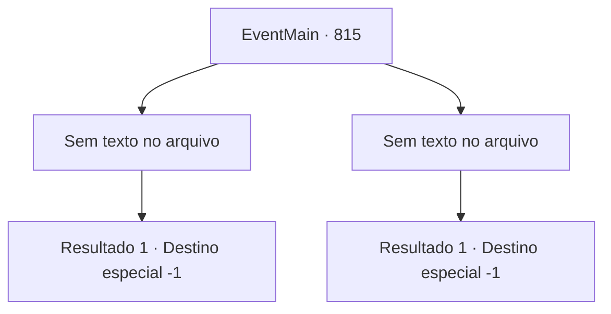

# Eventos principais · 815

[Índice da tabela](index.md) · [Índice geral](../index.md)

ID: `pt:EventMain:815` · Fonte: `EventMain4` · Versão: 1.2.47.

Mapeamento estático dos arquivos; a disponibilidade e a execução dependem do estado da run.

## Texto do evento

*Sem texto no arquivo.*

## Dados de entrada

```json
{
  "id": 815,
  "grade": 1,
  "normalGoal": "",
  "required": ""
}
```

## Mapa das escolhas



## Escolhas e resultados

### Escolha 1

*Sem texto no arquivo; o papel dessa opção depende da interface do jogo.*

Requisitos e outros campos da escolha:

```json
{
  "required": ""
}
```

#### Resultado 1.1

Você se aproxima do cambaleante Publius. Ele já foi fatalmente ferido em vários lugares e não pode mais lutar. 

 "Tossindo!... Você acabou sendo manipulado pelo demônio? Sua vingança era a vontade de Kior desde o início...!"

 Você levanta sua arma, ignorando os gritos de Publius. E isso põe fim à sua vida. 

 "Bom trabalho {1}. Isso trará paz à sua família. Haha"

 Quando Publius morre, o portal que costumava emitir luz desaparece. Kior mata todos os Paladinos restantes ordenando aos demônios e absorvendo suas almas. Quando você pede a ele para retornar ao mundo material, Kior prontamente aceita o pedido. 

 "Bom. {1} Mas é triste partir assim. Faremos um festival, então divirta-se."

 Ele convoca demônios para realizar um festival sem ouvir sua opinião. Você se senta ao lado de Danica e observa o festival deles.

Continuação registrada: [Destino especial `-1`](../destinos-especiais.md).

```json
{
  "required": "",
  "chance": "1",
  "nextEvent": -1,
  "type": 2,
  "reward": "15_5_14|15_5_33"
}
```

### Escolha 2

*Sem texto no arquivo; o papel dessa opção depende da interface do jogo.*

Requisitos e outros campos da escolha:

```json
{
  "required": ""
}
```

#### Resultado 2.1

Você é perfurado pela lança de luz e vomita sangue. Você pode sentir a morte se aproximando, e Publius realiza milagres novamente. Você, que eventualmente desmoronou, olha para o palácio que se tornou um campo de batalha com visão turva. Demônios e os Paladinos estão se enredando e matando uns aos outros. Então, você ouve a voz de Kior. 

 "Desculpe. {1}. Não se preocupe. Eu usarei suas almas, assim como as deles."

 Chega um sono profundo em que você não consegue pensar no significado das palavras de Kior.

Continuação registrada: [Destino especial `-1`](../destinos-especiais.md).

```json
{
  "required": "",
  "chance": "1",
  "nextEvent": -1,
  "type": 2,
  "reward": "0_0_-1|0_1_-1|15_5_40|15_5_14|15_5_33"
}
```

## Referências que chegam a este evento

- [Evento 813 · escolha 2 · resultado 1](0813.md#escolha-2)
