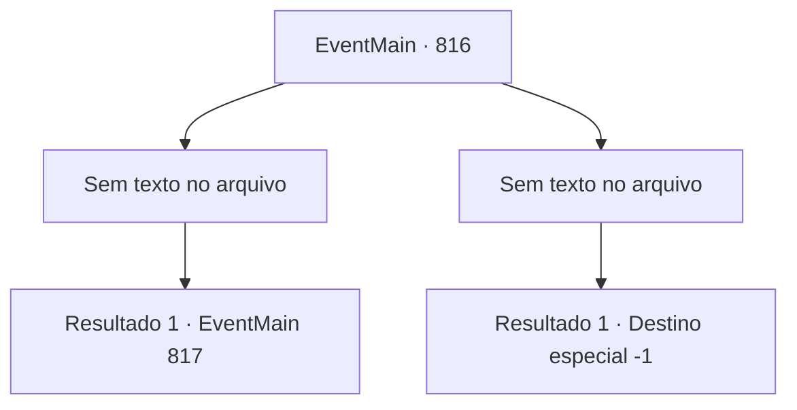

# Eventos principais · 816

[Índice da tabela](index.md) · [Índice geral](../index.md)

ID: `pt:EventMain:816` · Fonte: `EventMain4` · Versão: 1.2.47.

Mapeamento estático dos arquivos; a disponibilidade e a execução dependem do estado da run.

## Texto do evento

*Sem texto no arquivo.*

## Dados de entrada

```json
{
  "id": 816,
  "grade": 1,
  "normalGoal": "",
  "required": ""
}
```

## Mapa das escolhas



## Escolhas e resultados

### Escolha 1

*Sem texto no arquivo; o papel dessa opção depende da interface do jogo.*

Requisitos e outros campos da escolha:

```json
{
  "required": ""
}
```

#### Resultado 1.1

Com um som metálico, a espada de Onil ricocheteia. Você aproveita o momento. Você empunha uma arma no pescoço de Onil.

 'Clink!'

 Mas sua espada não toca o pescoço de Onil. Valen, que aparece de repente, te bloqueia. 

 "Segure aqueles que estão possuídos pelo mal!"

 Talvez seja porque a luta se prolongou demais, mas ela é apenas uma entre muitos que apareceram. Junto com Publius, muitos Paladinos surgem na praça e te cercam. 

 "Luz! Dê aos seus servos a força para derrotar o mal!"

 A luz da mão de Publius envolve os Paladinos. E os Paladinos avançam em sua direção.

Continuação registrada: [Evento 817](0817.md) na mesma tabela.

```json
{
  "required": "",
  "chance": "1",
  "nextEvent": 817,
  "type": 2,
  "reward": "6_3_149",
  "place": 10
}
```

### Escolha 2

*Sem texto no arquivo; o papel dessa opção depende da interface do jogo.*

Requisitos e outros campos da escolha:

```json
{
  "required": ""
}
```

#### Resultado 2.1

Você se ajoelha na espada de Onil. Os Paladinos se reúnem na praça e eles te prendem e a Danica. Entre eles estão Publius e Valen. Olhando para você capturado, Onil fala com uma voz fria. 

 "Levem-no para a prisão imediatamente. Não pensei que o servo de Kior estivesse na catedral..."

 Arrastado pelos Paladinos, você grita para Onil: 'Por que você queimou minha família?' Ele parece surpreso com seu grito, mas não responde à sua pergunta.

Continuação registrada: [Destino especial `-1`](../destinos-especiais.md).

```json
{
  "required": "",
  "chance": "1",
  "nextEvent": -1,
  "type": 2,
  "reward": "0_0_-1|0_1_-1|15_5_2|15_5_14|15_5_32"
}
```

## Referências que chegam a este evento

- [Evento 810 · escolha 1 · resultado 2](0810.md#escolha-1)
- [Evento 821 · escolha 1 · resultado 1](0821.md#escolha-1)
