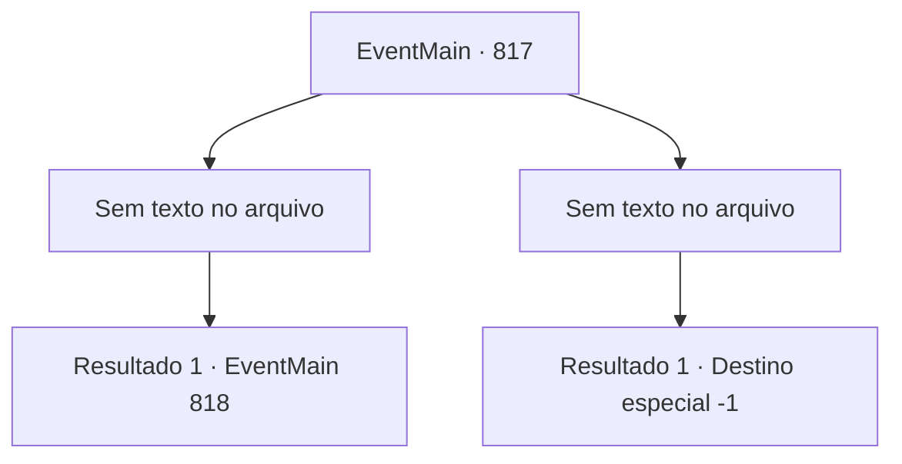

# Eventos principais · 817

[Índice da tabela](index.md) · [Índice geral](../index.md)

ID: `pt:EventMain:817` · Fonte: `EventMain4` · Versão: 1.2.47.

Mapeamento estático dos arquivos; a disponibilidade e a execução dependem do estado da run.

## Texto do evento

*Sem texto no arquivo.*

## Dados de entrada

```json
{
  "id": 817,
  "grade": 1,
  "normalGoal": "",
  "required": ""
}
```

## Mapa das escolhas



## Escolhas e resultados

### Escolha 1

*Sem texto no arquivo; o papel dessa opção depende da interface do jogo.*

Requisitos e outros campos da escolha:

```json
{
  "required": ""
}
```

#### Resultado 1.1

Até mesmo os Paladinos na luz divina não conseguem te vencer. Você se livra de Onil, que vem em sua direção novamente. E ergue sua arma para quebrar até mesmo o fôlego de Valen naquele momento. Você ouve a voz de Publius. A voz é poderosa o suficiente para te forçar. <b><link=shake>

 "Ajoelhe-se!"

</link></b> O que Publius diz é um feitiço chamado 'palavra de poder' que força a ação de alguém. Suas pernas estão tentando se ajoelhar independentemente da sua vontade.

Continuação registrada: [Evento 818](0818.md) na mesma tabela.

```json
{
  "required": "",
  "chance": "1",
  "nextEvent": 818,
  "type": 2,
  "reward": ""
}
```

### Escolha 2

*Sem texto no arquivo; o papel dessa opção depende da interface do jogo.*

Requisitos e outros campos da escolha:

```json
{
  "required": ""
}
```

#### Resultado 2.1

Os Paladinos, cercados pela luz divina, exercem seu poder avassalador. Você, que não tinha como escapar, acabou sendo derrotado por eles e capturado. Publius fala enquanto olha para você ajoelhado. 

 "Levem-no para a prisão. Eu o interrogarei mais tarde."

 Ouvindo a voz, você percebe que tudo acabou. Você é levado para uma prisão fria pelos Paladinos.

Continuação registrada: [Destino especial `-1`](../destinos-especiais.md).

```json
{
  "required": "",
  "chance": "1",
  "nextEvent": -1,
  "type": 2,
  "reward": "0_0_-1|0_1_-1|15_5_2|15_5_14|15_5_32"
}
```

## Referências que chegam a este evento

- [Evento 816 · escolha 1 · resultado 1](0816.md#escolha-1)
