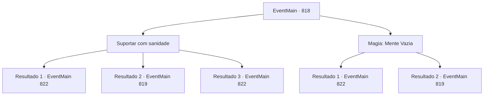

# Eventos principais · 818

[Índice da tabela](index.md) · [Índice geral](../index.md)

ID: `pt:EventMain:818` · Fonte: `EventMain4` · Versão: 1.2.47.

Mapeamento estático dos arquivos; a disponibilidade e a execução dependem do estado da run.

## Texto do evento

*Sem texto no arquivo.*

## Dados de entrada

```json
{
  "id": 818,
  "grade": 1,
  "normalGoal": "",
  "required": ""
}
```

## Mapa das escolhas



## Escolhas e resultados

### Escolha 1

Suportar com sanidade

Requisitos e outros campos da escolha:

```json
{
  "required": ""
}
```

#### Resultado 1.1

Você supera a Palavra de Poder com sanidade e deixa Valen sem fôlego. No choque da quebra da palavra de poder, Publius vomita sangue e se ajoelha. 

 "Kuh...! Você... Seus pecados nunca serão perdoados por Tere!!"

 Publius profere palavras de maldição contra você, mas não consegue detê-lo. Você se aproxima de Publius e lhe dá uma morte desastrosa. Então, um sorriso se forma em torno de sua boca. 

 "Arcebispo...!"

 Devido à morte de Publius, os paladinos ou fogem com medo ou desistem de tudo e se sentam. Você os ignora e dedica a alma de Publius a Kior. Logo você ouve a voz satisfeita de Kior. 

 "Khahaha!!! Ótimo! É excelente! Bem, vou retribuir sua dedicação. Receba minha força. Vou lhe dar o poder que você nunca experimentou antes."

 E então, com esse poder, Ele lhe diz para apagar tudo sobre Tere.

Continuação registrada: [Evento 822](0822.md) na mesma tabela.

```json
{
  "required": "24_7_1",
  "chance": "1|0_14_1",
  "nextEvent": 822,
  "type": 0,
  "reward": "15_5_32"
}
```

#### Resultado 1.2

Você não consegue vencer a Palavra de Poder e acaba de joelhos. Em breve, você ouvirá a segunda palavra de poder de Publius. <b><link=shake>

 "Segure sua garganta!"

</link></b> Com essa voz, suas mãos vão para o seu pescoço.

Continuação registrada: [Evento 819](0819.md) na mesma tabela.

```json
{
  "required": "24_7_1",
  "chance": "20",
  "nextEvent": 819,
  "type": 1,
  "reward": ""
}
```

#### Resultado 1.3

Você supera a Palavra de Poder com sanidade e deixa Valen sem fôlego. A dominação da Palavra de Poder era fraca, graças à sua forte resistência. No choque da quebra da palavra de poder, Publius vomita sangue e se ajoelha. 

 "Kuh..! Você... Seus pecados nunca serão perdoados por Tere!!"

 Publius profere palavras de maldição contra você, mas ele não pode impedi-lo. Você se aproxima de Publius e lhe dá uma morte desastrosa. Então, um sorriso se forma em torno de sua boca. 

 "Arcebispo...!"

 Devido à morte de Publius, os paladinos ou fogem com medo ou desistem de tudo e se sentam. Você os ignora e dedica a alma de Publius a Kior. Logo você ouve a voz satisfeita de Kior. 

 "Khahaha!!! Ótimo! É excelente! Bem, vou retribuir sua dedicação. Receba minha força. Vou lhe dar o poder que você nunca experimentou antes."

 E então, com esse poder, Ele lhe diz para apagar tudo sobre Tere.

Continuação registrada: [Evento 822](0822.md) na mesma tabela.

```json
{
  "required": "23_7_1",
  "chance": "1",
  "nextEvent": 822,
  "type": 2,
  "reward": "15_5_32"
}
```

### Escolha 2

Magia: Mente Vazia

Requisitos e outros campos da escolha:

```json
{
  "required": "20_0_3|1_1_2"
}
```

#### Resultado 2.1

Você usa um bloqueio mental que invalida a magia mental para resistir à palavra de poder. No choque da quebra da palavra de poder, Publius vomita sangue e se ajoelha. 

 "Kuh..! Você... Seus pecados nunca serão perdoados por Tere!!"

 Publius profere palavras de maldição contra você, mas ele não pode impedi-lo. Você deixa Valen sem palavras. Você se aproxima de Publius e lhe dá uma morte desastrosa. Então, um sorriso se forma em torno de sua boca. 

 "Arcebispo...!"

 Devido à morte de Publius, os paladinos ou fogem com medo ou desistem de tudo e se sentam. Você os ignora e dedica a alma de Publius a Kior. Logo você ouve a voz satisfeita de Kior. 

 "Khahaha!!! Ótimo! É excelente! Bem, vou retribuir sua dedicação. Receba minha força. Vou lhe dar o poder que você nunca experimentou antes."

 E então, com esse poder, Ele lhe diz para apagar tudo sobre Tere.

Continuação registrada: [Evento 822](0822.md) na mesma tabela.

```json
{
  "required": "",
  "chance": "1|0_7_1|0_12_1",
  "nextEvent": 822,
  "type": 0,
  "reward": "15_5_32|0_1_-1"
}
```

#### Resultado 2.2

Para resistir à palavra de poder, você tenta usar um bloqueio mental que invalida a magia mental. No entanto, a palavra de poder entra em efeito antes de você tentar o bloqueio mental. Você acaba de joelhos sem perceber e logo se depara com a segunda palavra de poder de Publius. <b><link=shake>

 "Estrangular você!"

</link></b>

Continuação registrada: [Evento 819](0819.md) na mesma tabela.

```json
{
  "required": "",
  "chance": "30",
  "nextEvent": 819,
  "type": 1,
  "reward": "0_1_-1"
}
```

## Referências que chegam a este evento

- [Evento 817 · escolha 1 · resultado 1](0817.md#escolha-1)
