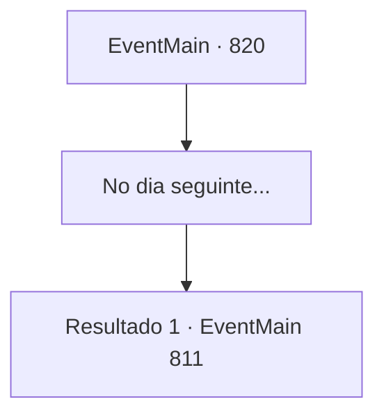

# Eventos principais · 820

[Índice da tabela](index.md) · [Índice geral](../index.md)

ID: `pt:EventMain:820` · Fonte: `EventMain4` · Versão: 1.2.47.

Mapeamento estático dos arquivos; a disponibilidade e a execução dependem do estado da run.

## Texto do evento

*Sem texto no arquivo.*

## Dados de entrada

```json
{
  "id": 820,
  "grade": 1,
  "normalGoal": "",
  "required": ""
}
```

## Mapa das escolhas



## Escolhas e resultados

### Escolha 1

No dia seguinte...

Requisitos e outros campos da escolha:

```json
{
  "required": ""
}
```

#### Resultado 1.1

No dia seguinte, você vai à catedral na hora certa. Ao entrar na praça atrás da catedral, há muitos paladinos fortemente armados se preparando para a batalha. Publius aumenta a moral com seus discursos e, eventualmente, Danica aparece e fica no centro do círculo mágico. 

 "Um grande homem! Os Cordeiros se reúnem para rezar! Por favor, nos dê um meio de nos conectarmos com o mundo."

 Enquanto Danica recita um feitiço, a luz se espalha a partir do círculo mágico. Caracteres rúnicos esculpidos no chão surgem no ar e giram ao redor da catedral, e uma mana poderosa varre como uma rajada de vento. <color=red> 

 "Kior! Por favor, mostre-me o seu mundo."

</color> Então, o mundo vira de cabeça para baixo em sua última palavra.

Continuação registrada: [Evento 811](0811.md) na mesma tabela.

```json
{
  "required": "",
  "chance": "1",
  "nextEvent": 811,
  "type": 2,
  "reward": ""
}
```

## Referências que chegam a este evento

- [Evento 809 · escolha 1 · resultado 1](0809.md#escolha-1)
- [Evento 809 · escolha 2 · resultado 1](0809.md#escolha-2)
- [Evento 809 · escolha 3 · resultado 1](0809.md#escolha-3)
- [Evento 810 · escolha 1 · resultado 1](0810.md#escolha-1)
- [Evento 810 · escolha 2 · resultado 1](0810.md#escolha-2)
