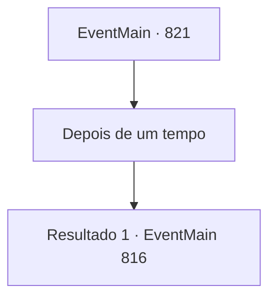

# Eventos principais · 821

[Índice da tabela](index.md) · [Índice geral](../index.md)

ID: `pt:EventMain:821` · Fonte: `EventMain4` · Versão: 1.2.47.

Mapeamento estático dos arquivos; a disponibilidade e a execução dependem do estado da run.

## Texto do evento

*Sem texto no arquivo.*

## Dados de entrada

```json
{
  "id": 821,
  "grade": 1,
  "normalGoal": "",
  "required": ""
}
```

## Mapa das escolhas



## Escolhas e resultados

### Escolha 1

Depois de um tempo

Requisitos e outros campos da escolha:

```json
{
  "required": ""
}
```

#### Resultado 1.1

Há quanto tempo tem sido? Você está esperando por Danica, escondido no corredor da catedral. Para ter certeza de que ela consertou corretamente o círculo mágico. E logo depois, você verifica os resultados. Onil, o inimigo da família e o paladino dos Lizardfolk, vem até você, segurando o pescoço de uma Danica desmaiada. 

 "Aqui está. Tolo, possuído pelo demônio"

 Escamas douradas e olhos rasgados verticalmente. Encarando aquele olhar, você saca sua arma. Você e Onil se lançam um contra o outro e cruzam as armas.

Continuação registrada: [Evento 816](0816.md) na mesma tabela.

```json
{
  "required": "",
  "chance": "1",
  "nextEvent": 816,
  "type": 2,
  "reward": "6_0_145",
  "place": 10
}
```

## Referências que chegam a este evento

- [Evento 809 · escolha 1 · resultado 2](0809.md#escolha-1)
- [Evento 809 · escolha 3 · resultado 2](0809.md#escolha-3)
