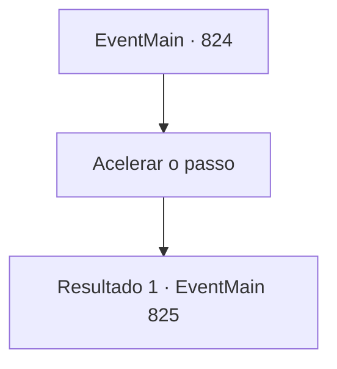

# Eventos principais · 824

[Índice da tabela](index.md) · [Índice geral](../index.md)

ID: `pt:EventMain:824` · Fonte: `EventMain4` · Versão: 1.2.47.

Mapeamento estático dos arquivos; a disponibilidade e a execução dependem do estado da run.

## Texto do evento

Você estava a caminho de encontrar os seguidores no vilarejo de Kahida. Nesse momento, você ouviu vozes conversando perto do rio. 

 "Você ouviu? Um tal de Vi...Viyor-alguma-coisa... não lembro o nome direito, mas era um cavaleiro, foi pego por estar em cooperar com o demônio e fugiu para outro país!"

 Quando você olhou para o rio, viu algumas mulheres lavando roupas e conversando animadamente. Elas continuaram comentando que a Igreja de Tere estava planejando caçar os adoradores de demônios e que poderiam pedir apoio a outras dioceses. Enquanto ouvia em silêncio, Kior sussurrou em sua mente. 

 "Eu sabia que Viyork tinha fugido. Não podemos perder tempo... os movimentos da Igreja de Tere estão ficando suspeitos..."


## Dados de entrada

```json
{
  "id": 824,
  "grade": 1,
  "normalGoal": "",
  "required": "13_4_26|1_2_100"
}
```

## Mapa das escolhas



## Escolhas e resultados

### Escolha 1

Acelerar o passo

Requisitos e outros campos da escolha:

```json
{
  "required": ""
}
```

#### Resultado 1.1

Você se apressa em direção à Vila Kahida, aceitando as palavras de Kior.

 Dois dias depois, Ao chegar na Vila Kahida, você encontra uma pessoa que se apresenta como 'Gess'. |drawing_gess| Gess tem cabelos brancos, suas gengivas estão colapsadas e seus olhos estão turvos. Mas o olhar em seu rosto ao te ver está cheio de alegria. Ele te cumprimenta junto com outros adoradores de demônios. 

 "Nós, nós estávamos es, esperando por você"

 Ele diz que ouviu sua performance e te olha como uma criança animada ao ver um brinquedo. Então ele pede uma chance de se dedicar a você e Kior.

Continuação registrada: [Evento 825](0825.md) na mesma tabela.

```json
{
  "required": "",
  "chance": "1",
  "nextEvent": 825,
  "type": 2,
  "reward": ""
}
```

## Referências que chegam a este evento

Nenhum `nextEvent` positivo da mesma tabela aponta para este nó. Isso não prova que seja inacessível: sorteio e estado de história podem selecioná-lo.

