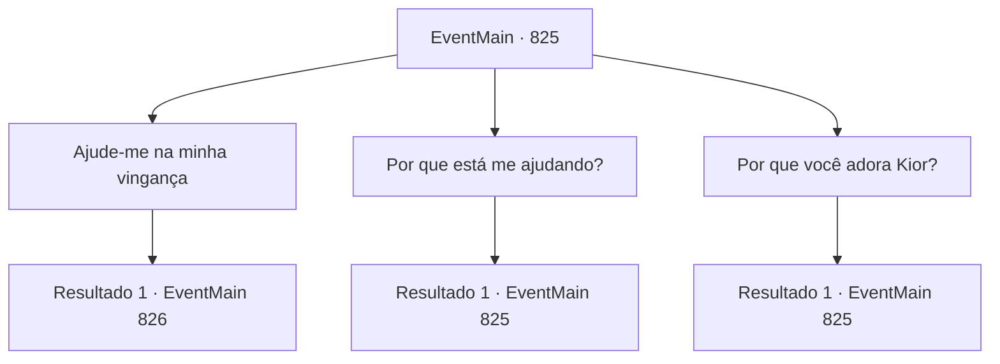

# Eventos principais · 825

[Índice da tabela](index.md) · [Índice geral](../index.md)

ID: `pt:EventMain:825` · Fonte: `EventMain4` · Versão: 1.2.47.

Mapeamento estático dos arquivos; a disponibilidade e a execução dependem do estado da run.

## Texto do evento

*Sem texto no arquivo.*

## Dados de entrada

```json
{
  "id": 825,
  "grade": 1,
  "normalGoal": "",
  "required": ""
}
```

## Mapa das escolhas



## Escolhas e resultados

### Escolha 1

Ajude-me na minha vingança

Requisitos e outros campos da escolha:

```json
{
  "required": ""
}
```

#### Resultado 1.1

Gess responde com voz trêmula às suas palavras de vingança. 

 "Claro, claro. Con, contratante... Nós, nós já co, coletamos as informações de Tere para você e seu mestre."

 Gess tira a carta de seus braços e mostra para você. Olhando para ela, você percebe que a conversa das mulheres que ouviu dois dias atrás era verdadeira. Diz que Publius está buscando apoio da Igreja Teretiana em outro país. 

 "Desde que ele perdeu seu subordinado de confiança, ele deve estar tentando te pegar com o poder de outra diocese."

 Gess diz que já descobriu o dia e o caminho da jornada de Publius para outro país. 

 "O que você faria? O Arcebispo ainda está na Catedral de Yerut"


Continuação registrada: [Evento 826](0826.md) na mesma tabela.

```json
{
  "required": "",
  "chance": "1",
  "nextEvent": 826,
  "type": 2,
  "reward": ""
}
```

### Escolha 2

Por que está me ajudando?

Requisitos e outros campos da escolha:

```json
{
  "required": "5_429_0"
}
```

#### Resultado 2.1

Gess responde à sua pergunta com um brilho nos olhos. 

 "Nós temos estado ocupados fugindo dos Teretianos"

 Eles têm servido o Kior em condições precárias, correndo de um lugar para outro para escapar da opressão de Tere. Mas com a sua aparição, eles ousam enfrentar os Teretianos, e ele irá ajudá-lo a não perder essa oportunidade.

Continuação registrada: [Evento 825](0825.md) na mesma tabela.

```json
{
  "required": "",
  "chance": "1",
  "nextEvent": 825,
  "type": 2,
  "reward": "5_429_1"
}
```

### Escolha 3

Por que você adora Kior?

Requisitos e outros campos da escolha:

```json
{
  "required": "5_430_0"
}
```

#### Resultado 3.1

Você pergunta a Gess por que ele adora o kior. Gess responde com uma voz confiante. Ele diz que o kior veio a este mundo e matou os podres, o kior reconstruirá o mundo com um paraíso apenas para aqueles que o servem, e ele acredita firmemente nisso e não tem dúvidas sobre isso.

Continuação registrada: [Evento 825](0825.md) na mesma tabela.

```json
{
  "required": "",
  "chance": "1",
  "nextEvent": 825,
  "type": 2,
  "reward": "5_430_1"
}
```

## Referências que chegam a este evento

- [Evento 824 · escolha 1 · resultado 1](0824.md#escolha-1)
- [Evento 825 · escolha 2 · resultado 1](0825.md#escolha-2)
- [Evento 825 · escolha 3 · resultado 1](0825.md#escolha-3)
