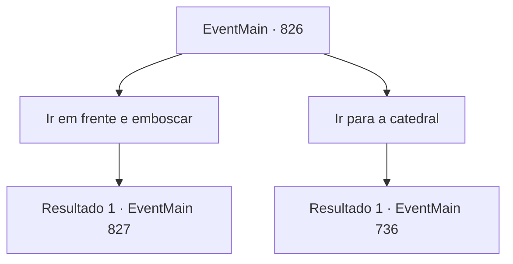

# Eventos principais · 826

[Índice da tabela](index.md) · [Índice geral](../index.md)

ID: `pt:EventMain:826` · Fonte: `EventMain4` · Versão: 1.2.47.

Mapeamento estático dos arquivos; a disponibilidade e a execução dependem do estado da run.

## Texto do evento

*Sem texto no arquivo.*

## Dados de entrada

```json
{
  "id": 826,
  "grade": 1,
  "normalGoal": "",
  "required": ""
}
```

## Mapa das escolhas



## Escolhas e resultados

### Escolha 1

Ir em frente e emboscar

Requisitos e outros campos da escolha:

```json
{
  "required": ""
}
```

#### Resultado 1.1

Você diz para seguir em frente e emboscar e atacar Publius. Gess presta homenagem à decisão, dizendo que é uma ótima decisão. Você chega em uma colina com vista para o Caminho do Louvor com adoradores. De acordo com as informações enviadas pelos homens de Gess, o arcebispo passará por aqui. Assim se passa meio dia. Um corvo voa sobre o ombro de Gess e lhe entrega uma nota com uma mordida na boca. 

 "O que é isso...?"

 Gess olha para a nota e franze a testa, e mostra para você. Diz que vários vagões saíram da catedral em direções diferentes simultaneamente. Dizem que um lado estava indo para a Montanha Grandeum, o outro para o Caminho do Louvor e o outro para o Rio Kailes. Gess pergunta cuidadosamente, olhando para sua perspicácia. 

 "Eu não ex, esperava is, isso... O que devo fazer?"


Continuação registrada: [Evento 827](0827.md) na mesma tabela.

```json
{
  "required": "",
  "chance": "1",
  "nextEvent": 827,
  "type": 2,
  "reward": ""
}
```

### Escolha 2

Ir para a catedral

Requisitos e outros campos da escolha:

```json
{
  "required": ""
}
```

#### Resultado 2.1

Você decide avançar para a Catedral de Yerut. Gess presta homenagem à decisão e guia você até a catedral. 

 Alguns dias depois, você chega perto de Regirique e olha para a cidade do topo da colina. A cidade é cercada por três muralhas. O local é altamente guardado. Gess começa a suar frio quando vê isso. 

 "Vai, vai ser di, difícil passar di, diretamente por aqui"


Continuação registrada: [Evento 736](0736.md) na mesma tabela.

```json
{
  "required": "",
  "chance": "1",
  "nextEvent": 736,
  "type": 2,
  "reward": ""
}
```

## Referências que chegam a este evento

- [Evento 825 · escolha 1 · resultado 1](0825.md#escolha-1)
