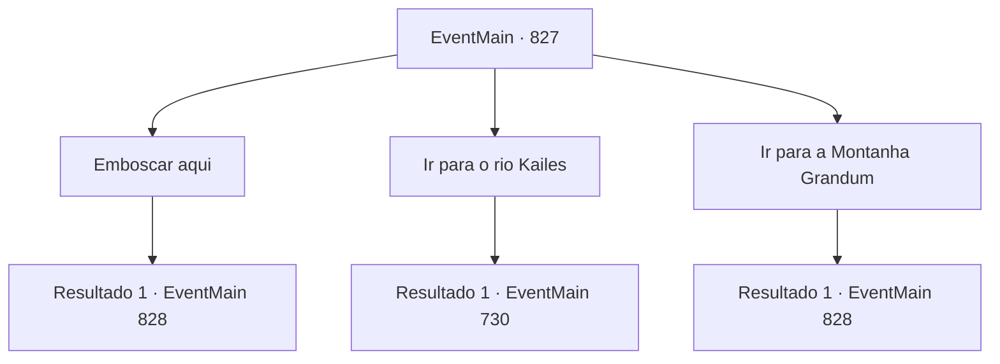

# Eventos principais · 827

[Índice da tabela](index.md) · [Índice geral](../index.md)

ID: `pt:EventMain:827` · Fonte: `EventMain4` · Versão: 1.2.47.

Mapeamento estático dos arquivos; a disponibilidade e a execução dependem do estado da run.

## Texto do evento

*Sem texto no arquivo.*

## Dados de entrada

```json
{
  "id": 827,
  "grade": 1,
  "normalGoal": "",
  "required": ""
}
```

## Mapa das escolhas



## Escolhas e resultados

### Escolha 1

Emboscar aqui

Requisitos e outros campos da escolha:

```json
{
  "required": ""
}
```

#### Resultado 1.1

Você decide emboscar em uma colina com vista para o caminho de louvor. À medida que o tempo passa, o pôr do sol cai no céu e o caminho de louvor fica amarelo. E então um casal de carroças com padrão Teretiano entra no caminho de louvor. Quando eles chegam ao meio da estrada, Você envia um sinal para atacar o desfile de carroças com adoradores. 

 "Eles são adoradores de demônios!"

 Nessas carroças, os Paladinos saem correndo e começam a atacar os adoradores. Eles parecem muito calmos, como se soubessem que você estava chegando. Você olha rapidamente para os rostos deles. Mas nenhum deles é Publius.

Continuação registrada: [Evento 828](0828.md) na mesma tabela.

```json
{
  "required": "",
  "chance": "1",
  "nextEvent": 828,
  "type": 2,
  "reward": "6_0_50",
  "place": 0
}
```

### Escolha 2

Ir para o rio Kailes

Requisitos e outros campos da escolha:

```json
{
  "required": ""
}
```

#### Resultado 2.1

Você se apressa em direção ao Rio Kailes. À medida que o tempo passa, o pôr do sol cai no céu e o rio fica amarelo. Quando você chega ao Rio Kailes, se esconde e olha ao redor. Então você encontra pessoas acampadas e descansando perto do rio. Há um homem entre eles que chama sua atenção. Ele é um homem mais velho, vestido com um manto vermelho ricamente bordado, com rugas profundas na testa e uma barba que cobre toda a mandíbula inferior. |drawing_publius| 

 "Aquele, aquele é o Pu, Publius!"

 Você olha para Publius com um aceno para a explicação de gess. Talvez por causa da distância, Publius está conversando com os paladinos ao seu redor sem perceber você.

Continuação registrada: [Evento 730](0730.md) na mesma tabela.

```json
{
  "required": "",
  "chance": "1",
  "nextEvent": 730,
  "type": 2,
  "reward": ""
}
```

### Escolha 3

Ir para a Montanha Grandum

Requisitos e outros campos da escolha:

```json
{
  "required": ""
}
```

#### Resultado 3.1

Você se apressa e segue em direção à Montanha Grandeum. À medida que o tempo passa, o pôr do sol cai no céu e a montanha fica laranja. Você e os adoradores, cansados de correr até aqui, fazem uma pequena pausa, respirando pesadamente. Então, alguns vagões com padrões Teretianos aparecem na sua frente. 

 "Adoradores de demônios!"

 Nos vagões, os Paladinos saem correndo e começam a atacar os adoradores. Eles parecem muito calmos, como se soubessem que você estava chegando. Você olha rapidamente para os rostos deles. Mas nenhum deles é Publius.

Continuação registrada: [Evento 828](0828.md) na mesma tabela.

```json
{
  "required": "",
  "chance": "1",
  "nextEvent": 828,
  "type": 2,
  "reward": "6_3_50",
  "place": 1
}
```

## Referências que chegam a este evento

- [Evento 826 · escolha 1 · resultado 1](0826.md#escolha-1)
