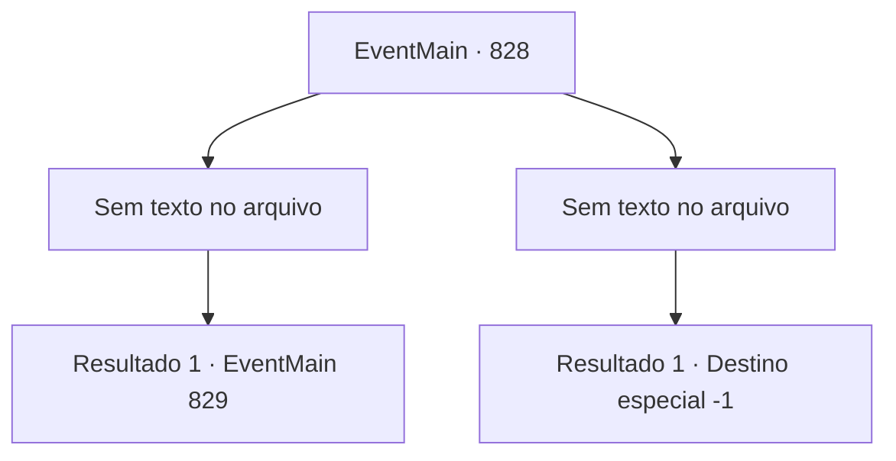

# Eventos principais · 828

[Índice da tabela](index.md) · [Índice geral](../index.md)

ID: `pt:EventMain:828` · Fonte: `EventMain4` · Versão: 1.2.47.

Mapeamento estático dos arquivos; a disponibilidade e a execução dependem do estado da run.

## Texto do evento

*Sem texto no arquivo.*

## Dados de entrada

```json
{
  "id": 828,
  "grade": 1,
  "normalGoal": "",
  "required": ""
}
```

## Mapa das escolhas



## Escolhas e resultados

### Escolha 1

*Sem texto no arquivo; o papel dessa opção depende da interface do jogo.*

Requisitos e outros campos da escolha:

```json
{
  "required": ""
}
```

#### Resultado 1.1

Os paladinos de Tere são derrubados por você e pelos adoradores. Você absorve suas almas e as dedica a Kior. Então, Gess se aproxima de você e diz, curvando-se. 

 "Não, Agora que está assim, não temos escolha a não ser ir para a catedral"

 Ele olha para você determinado, dizendo que nem mesmo tem medo da morte.

Continuação registrada: [Evento 829](0829.md) na mesma tabela.

```json
{
  "required": "",
  "chance": "1",
  "nextEvent": 829,
  "type": 2,
  "reward": ""
}
```

### Escolha 2

*Sem texto no arquivo; o papel dessa opção depende da interface do jogo.*

Requisitos e outros campos da escolha:

```json
{
  "required": ""
}
```

#### Resultado 2.1

Você cai na espada do paladino. 

 "Con, Empreiteiro! Eve, Todos, Vão, voltem!"

 Gess, que viu isso, se aproxima e te ajuda. E o resto dos adoradores bloqueiam o ataque dos paladinos, criando um espaço para você escapar. Depois de escapar por pouco, você se esconde nas colinas e recebe tratamento de Gess. 

 "Você está bem? Você tem um ferimento profundo, então é melhor adiar sua vingança para a próxima vez."

 Depois de vomitar sangue, você assente e recebe o apoio dele. Você segue para a Vila Kahida com os adoradores de demônios.

Continuação registrada: [Destino especial `-1`](../destinos-especiais.md).

```json
{
  "required": "",
  "chance": "1",
  "nextEvent": -1,
  "type": 2,
  "reward": "0_0_-1|0_1_-1|15_5_18|15_5_41"
}
```

## Referências que chegam a este evento

- [Evento 827 · escolha 1 · resultado 1](0827.md#escolha-1)
- [Evento 827 · escolha 3 · resultado 1](0827.md#escolha-3)
