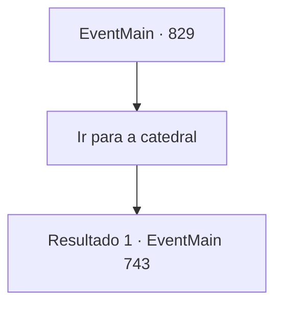

# Eventos principais · 829

[Índice da tabela](index.md) · [Índice geral](../index.md)

ID: `pt:EventMain:829` · Fonte: `EventMain4` · Versão: 1.2.47.

Mapeamento estático dos arquivos; a disponibilidade e a execução dependem do estado da run.

## Texto do evento

*Sem texto no arquivo.*

## Dados de entrada

```json
{
  "id": 829,
  "grade": 1,
  "normalGoal": "",
  "required": ""
}
```

## Mapa das escolhas



## Escolhas e resultados

### Escolha 1

Ir para a catedral

Requisitos e outros campos da escolha:

```json
{
  "required": ""
}
```

#### Resultado 1.1

Você decide ir à Catedral de Yerut. Gess lidera o caminho até a catedral. 

 Alguns dias depois, você chega perto de Regirique e observa a cidade de uma colina baixa. A cidade é cercada por três muralhas. Há um número enorme de Paladinos guardando-a. Também há Publius, que fugiu da última vez. Ele te encontra e aos adoradores, levanta sua bengala e grita com todas as suas forças. 

 "Enfrentem as forças do mal!!"

 Com o grito, os portões se abrem e os paladinos a cavalo se lançam em sua direção e dos adoradores. Aqueles na frente estão vestidos com armaduras brancas e têm alabardas decoradas com ouro. 

 "Sigam o con, contratante!"

 Quando Gess grita, os adoradores gritam e cada um deles saca uma arma. Você lidera os adoradores na batalha contra o exército.

Continuação registrada: [Evento 743](0743.md) na mesma tabela.

```json
{
  "required": "",
  "chance": "1",
  "nextEvent": 743,
  "type": 2,
  "reward": "6_3_149",
  "place": 0
}
```

## Referências que chegam a este evento

- [Evento 828 · escolha 1 · resultado 1](0828.md#escolha-1)
