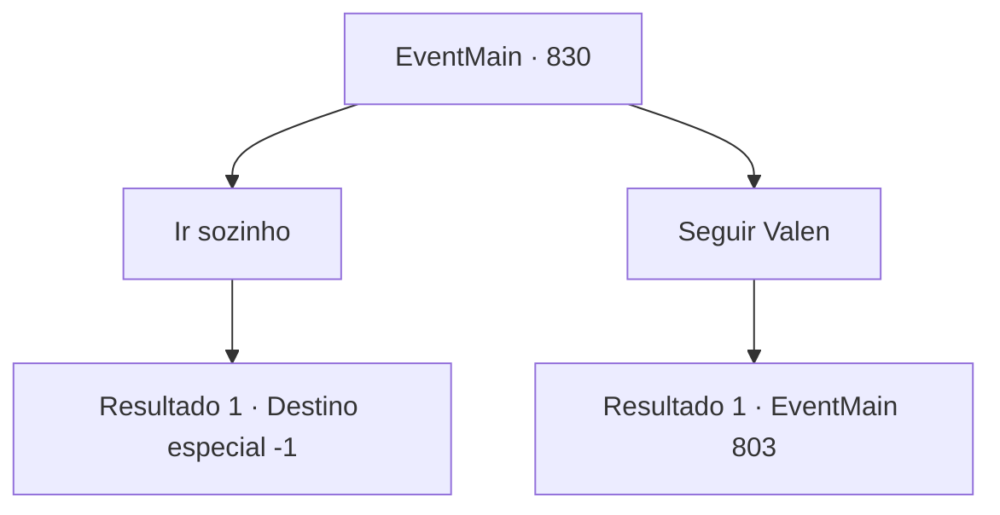

# Eventos principais · 830

[Índice da tabela](index.md) · [Índice geral](../index.md)

ID: `pt:EventMain:830` · Fonte: `EventMain4` · Versão: 1.2.47.

Mapeamento estático dos arquivos; a disponibilidade e a execução dependem do estado da run.

## Texto do evento

*Sem texto no arquivo.*

## Dados de entrada

```json
{
  "id": 830,
  "grade": 1,
  "normalGoal": "",
  "required": ""
}
```

## Mapa das escolhas



## Escolhas e resultados

### Escolha 1

Ir sozinho

Requisitos e outros campos da escolha:

```json
{
  "required": ""
}
```

#### Resultado 1.1

Devido à sua atitude firme, Valen finalmente desiste.  Ela decide voltar ao mundo material sozinha.  Depois que Valen sai, você vagueia lentamente pelo castelo de Kior.  Porque você tem que ficar aqui por um tempo.  |drawing_kiorDungeon|  Então você encontra uma prisão que fica profundamente sob o palácio.  Gritos de todos os tipos estão vindo da entrada lá.  Você entra na prisão em uma atração desconhecida.  E encontra sua família no final da atração.

Continuação registrada: [Destino especial `-1`](../destinos-especiais.md).

```json
{
  "required": "",
  "chance": "1",
  "nextEvent": -1,
  "type": 2,
  "reward": "15_5_20|15_5_29|15_5_39"
}
```

### Escolha 2

Seguir Valen

Requisitos e outros campos da escolha:

```json
{
  "required": ""
}
```

#### Resultado 2.1

Você volta pelo caminho que veio com Valen, matando o demônio. Ao pular de volta para a fenda dimensional, o choque sacode seu corpo com um calor intenso.

 Alguém sacode seu corpo e você abre os olhos. Olhando ao redor, você está deitado em uma cabana que nunca viu antes. Um homem mais velho vestindo uma túnica vermelha de padre e Onil estão olhando para você. Atrás deles, há muitos Paladinos de prontidão, e Valen fala com voz urgente. |drawing_publius| 

 "Ele é o arcebispo. Seja educado."

 Você olha para ele em branco ao ouvir suas palavras. O Arcebispo de Teretian, Publius, ordenou que sua família fosse queimada na fogueira, e Onil é quem executou a ordem. 

 "Eu ouvi falar disso através de Valen. Você matou Kior com Valen. Então... O que você vai fazer agora? É o fim da sua vingança? Se não for..."

 Olhando para você, Publius pergunta em voz baixa.

Continuação registrada: [Evento 803](0803.md) na mesma tabela.

```json
{
  "required": "",
  "chance": "1",
  "nextEvent": 803,
  "type": 2,
  "reward": ""
}
```

## Referências que chegam a este evento

- [Evento 802 · escolha 2 · resultado 2](0802.md#escolha-2)
