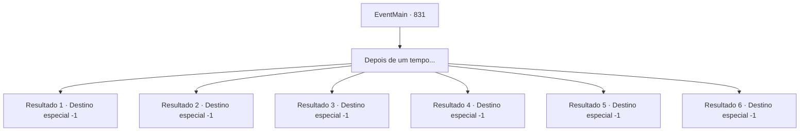

# Eventos principais · 831

[Índice da tabela](index.md) · [Índice geral](../index.md)

ID: `pt:EventMain:831` · Fonte: `EventMain4` · Versão: 1.2.47.

Mapeamento estático dos arquivos; a disponibilidade e a execução dependem do estado da run.

## Texto do evento

*Sem texto no arquivo.*

## Dados de entrada

```json
{
  "id": 831,
  "grade": 1,
  "normalGoal": "",
  "required": ""
}
```

## Mapa das escolhas



## Escolhas e resultados

### Escolha 1

Depois de um tempo...

Requisitos e outros campos da escolha:

```json
{
  "required": ""
}
```

#### Resultado 1.1

Você foi aprisionado na prisão dos elfos por várias semanas. No entanto, eles não mostram nenhuma intenção de libertá-lo. Isso significa que as negociações entre humanos e elfos não estão progredindo. Enquanto as negociações fracassam, você é condenado à morte, e agora tudo o que pode fazer é esperar pelo dia da sua morte.

Continuação registrada: [Destino especial `-1`](../destinos-especiais.md).

```json
{
  "required": "24_1_1",
  "chance": "1",
  "nextEvent": -1,
  "type": 2,
  "reward": "15_1_11|25_8_1"
}
```

#### Resultado 1.2

Você foi aprisionado na prisão dos elfos por várias semanas. No entanto, eles não mostram nenhuma intenção de libertá-lo. Então, alguém se aproxima da sua cela. Ele remove a máscara que cobre o rosto e sorri. O sorriso de Benjamin brilha ao luar. 

 "Desta vez, é minha vez de ajudar você."

 Seu companheiro cavaleiro ao lado dele ri e diz. 

 "Apenas confie em nós! Enquanto nossos cavaleiros estão distraindo a atenção deles, aproveite esta chance e escape!"

 Com a ajuda de Benjamin e seus camaradas, você escapa da prisão dos elfos.

Continuação registrada: [Destino especial `-1`](../destinos-especiais.md).

```json
{
  "required": "31_7_9",
  "chance": "1",
  "nextEvent": -1,
  "type": 2,
  "reward": "15_1_1"
}
```

#### Resultado 1.3

Você foi aprisionado na prisão dos elfos por várias semanas. No entanto, eles não mostram nenhuma intenção de libertá-lo. De repente, os elfos que guardam a prisão parecem estar enfeitiçados e desaparecem em algum lugar. Então, um adorável demônio aparece diante de você. Ela solta um pequeno suspiro e sorri maliciosamente. 

 "Suspiro... Como você pretende viver neste mundo perigoso sem mim?"

 Cira enrola sua cauda ao redor da porta da prisão e a arranca. No entanto, ela não solta as algemas em suas mãos e pés. Ela te levanta, voando com um sorriso ainda mais brincalhão no rosto.

Continuação registrada: [Destino especial `-1`](../destinos-especiais.md).

```json
{
  "required": "31_5_5",
  "chance": "1",
  "nextEvent": -1,
  "type": 2,
  "reward": "15_1_1"
}
```

#### Resultado 1.4

Você foi aprisionado na prisão dos elfos por várias semanas.  No entanto, eles não mostram nenhuma intenção de libertá-lo. De repente, um alarme de emergência soa na floresta dos elfos. Os elfos se agitam, pegando seus arcos e flechas. 

 "Droga... Não posso acreditar. Um dragão azul neste lugar frio?"

 O trovão, acompanhado de vários flashes de relâmpagos, retumba, e Ternach, guiado pelos elfos, aparece diante de você. 

 "Poxa, está frio aqui fora. Todos vocês estão bem? Não se preocupem comigo agora. Vamos, vamos."

 Ternach pega a prisão inteira em que você está preso e voa para o céu. Então, ele orgulhosamente lhe conta como 'negociou' com os elfos. 

 "Esses elfos começaram dizendo não, mas quando eu insinuei queimar suas florestas, a rainha deles ou algo assim finalmente cedeu. Eu fiz bem, não fiz?"

 Você agradece a Ternach em voz alta para que ele possa ouvir.

Continuação registrada: [Destino especial `-1`](../destinos-especiais.md).

```json
{
  "required": "-1|31_9_2|31_9_4",
  "chance": "1",
  "nextEvent": -1,
  "type": 2,
  "reward": "15_1_1"
}
```

#### Resultado 1.5

Você foi aprisionado na prisão dos elfos por várias semanas. No entanto, eles não mostram nenhuma intenção de libertá-lo. Isso significa que as negociações entre humanos e elfos não estão progredindo. Enquanto as negociações falham, você é condenado à morte, e agora tudo o que pode fazer é esperar pelo dia da sua morte.

Continuação registrada: [Destino especial `-1`](../destinos-especiais.md).

```json
{
  "required": "-1|31_5_7|31_5_8",
  "chance": "1",
  "nextEvent": -1,
  "type": 2,
  "reward": "15_1_11|29_5_7|29_5_8|14_5_10"
}
```

#### Resultado 1.6

Você foi aprisionado na prisão dos elfos por várias semanas. No entanto, eles não mostram nenhuma intenção de libertá-lo. Isso significa que as negociações entre humanos e elfos não estão progredindo. Enquanto as negociações falham, você é condenado à morte, e agora tudo o que pode fazer é esperar pelo dia da sua morte.

Continuação registrada: [Destino especial `-1`](../destinos-especiais.md).

```json
{
  "required": "23_1_1|33_7_9|31_5_5|33_9_2|33_9_4|33_5_7|33_5_8",
  "chance": "1",
  "nextEvent": -1,
  "type": 2,
  "reward": "15_1_11|25_8_1"
}
```

## Referências que chegam a este evento

- [Evento 47 · escolha 2 · resultado 3](0047.md#escolha-2)
- [Evento 47 · escolha 2 · resultado 5](0047.md#escolha-2)
- [Evento 64 · escolha 2 · resultado 2](0064.md#escolha-2)
- [Evento 64 · escolha 2 · resultado 3](0064.md#escolha-2)
- [Evento 65 · escolha 2 · resultado 2](0065.md#escolha-2)
- [Evento 65 · escolha 2 · resultado 3](0065.md#escolha-2)
- [Evento 66 · escolha 2 · resultado 2](0066.md#escolha-2)
- [Evento 66 · escolha 2 · resultado 3](0066.md#escolha-2)
