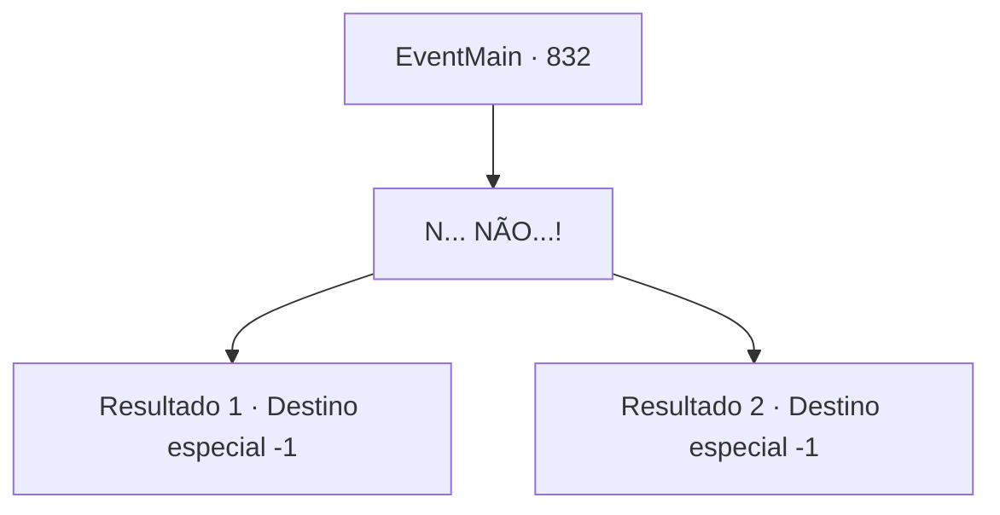

# Eventos principais · 832

[Índice da tabela](index.md) · [Índice geral](../index.md)

ID: `pt:EventMain:832` · Fonte: `EventMain4` · Versão: 1.2.47.

Mapeamento estático dos arquivos; a disponibilidade e a execução dependem do estado da run.

## Texto do evento

*Sem texto no arquivo.*

## Dados de entrada

```json
{
  "id": 832,
  "grade": 1,
  "normalGoal": "",
  "required": ""
}
```

## Mapa das escolhas



## Escolhas e resultados

### Escolha 1

N... NÃO...!

Requisitos e outros campos da escolha:

```json
{
  "required": ""
}
```

#### Resultado 1.1

No seu último grito, Halad na verdade ri ainda mais alto. 

 "Adeus. Eu vou fazer bom uso de você, então não se sinta muito injustiçado."

 Com sua zombaria, você perde a consciência.

Continuação registrada: [Destino especial `-1`](../destinos-especiais.md).

```json
{
  "required": "24_1_1",
  "chance": "1",
  "nextEvent": -1,
  "type": 2,
  "reward": ""
}
```

#### Resultado 1.2

No seu último grito, Halad na verdade ri ainda mais alto. 

 "Adeus. Eu vou fazer bom uso de você, então não se sinta muito injustiçado."

 Com sua zombaria, você perde a consciência.

Continuação registrada: [Destino especial `-1`](../destinos-especiais.md).

```json
{
  "required": "23_1_1",
  "chance": "1",
  "nextEvent": -1,
  "type": 2,
  "reward": "25_8_1"
}
```

## Referências que chegam a este evento

- [Evento 182 · escolha 2 · resultado 4](0182.md#escolha-2)
- [Evento 182 · escolha 2 · resultado 5](0182.md#escolha-2)
- [Evento 182 · escolha 2 · resultado 7](0182.md#escolha-2)
- [Evento 182 · escolha 2 · resultado 8](0182.md#escolha-2)
