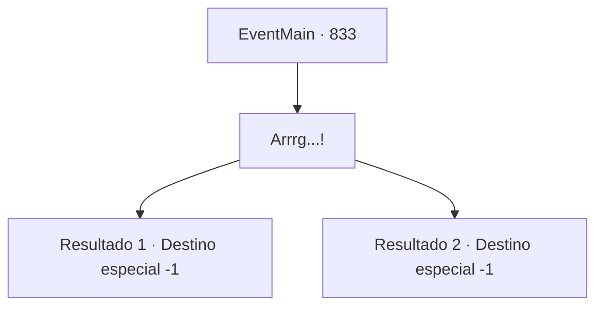

# Eventos principais · 833

[Índice da tabela](index.md) · [Índice geral](../index.md)

ID: `pt:EventMain:833` · Fonte: `EventMain4` · Versão: 1.2.47.

Mapeamento estático dos arquivos; a disponibilidade e a execução dependem do estado da run.

## Texto do evento

*Sem texto no arquivo.*

## Dados de entrada

```json
{
  "id": 833,
  "grade": 1,
  "normalGoal": "",
  "required": ""
}
```

## Mapa das escolhas



## Escolhas e resultados

### Escolha 1

Arrrg...!

Requisitos e outros campos da escolha:

```json
{
  "required": ""
}
```

#### Resultado 1.1

Você resiste a Anton, mas ele nem se abala. Conforme seu sangue é drenado, você fica mais fraco, enquanto ele se torna cada vez mais forte. Sua visão se turva, e, finalmente, sua consciência afunda na escuridão.

Continuação registrada: [Destino especial `-1`](../destinos-especiais.md).

```json
{
  "required": "24_1_1",
  "chance": "1",
  "nextEvent": -1,
  "type": 2,
  "reward": ""
}
```

#### Resultado 1.2

Você resiste a Anton, mas ele nem se abala. Conforme seu sangue é drenado, você fica mais fraco, enquanto ele se torna cada vez mais forte. Sua visão se turva, e, finalmente, sua consciência afunda na escuridão.

Continuação registrada: [Destino especial `-1`](../destinos-especiais.md).

```json
{
  "required": "23_1_1",
  "chance": "1",
  "nextEvent": -1,
  "type": 2,
  "reward": "25_8_1"
}
```

## Referências que chegam a este evento

- [Evento 368 · escolha 2 · resultado 3](0368.md#escolha-2)
- [Evento 368 · escolha 2 · resultado 4](0368.md#escolha-2)
