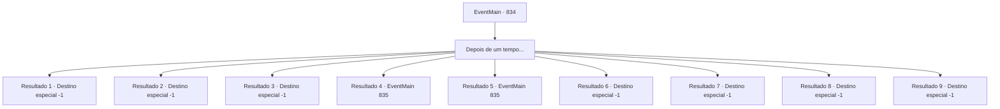

# Eventos principais · 834

[Índice da tabela](index.md) · [Índice geral](../index.md)

ID: `pt:EventMain:834` · Fonte: `EventMain4` · Versão: 1.2.47.

Mapeamento estático dos arquivos; a disponibilidade e a execução dependem do estado da run.

## Texto do evento

*Sem texto no arquivo.*

## Dados de entrada

```json
{
  "id": 834,
  "grade": 1,
  "normalGoal": "",
  "required": ""
}
```

## Mapa das escolhas



## Escolhas e resultados

### Escolha 1

Depois de um tempo...

Requisitos e outros campos da escolha:

```json
{
  "required": ""
}
```

#### Resultado 1.1

De fora da porta, a voz de Anton pode ser ouvida. 

 "Como você está aguentando, {1}?"

 Ele fala em um tom excessivamente relaxado, como se estivesse tentando propositalmente te irritar. 

 "Vamos ver... A luta da Fiana está prestes a começar em breve. Estou realmente preocupado se você estará bem no seu estado atual."

 Ele finge preocupação em sua voz. Então, ele adiciona, dando a você uma chamada oportunidade. 

 "Eu vou permitir que você lute no lugar dela. Considere isso um enorme 'favor'."

 A raiva faz suas mãos tremerem, mas proteger Fiana é sua maior prioridade. Relutantemente, você decide aceitar a oferta dele.

Continuação registrada: [Destino especial `-1`](../destinos-especiais.md).

```json
{
  "required": "24_1_1",
  "chance": "1",
  "nextEvent": -1,
  "type": 2,
  "reward": ""
}
```

#### Resultado 1.2

De fora da porta, a voz de Anton pode ser ouvida. 

 "Como você está aguentando, {1}?"

 Ele fala em um tom excessivamente relaxado, como se estivesse tentando propositalmente te irritar. 

 "Vamos ver... A luta da Fiana está prestes a começar em breve. Estou realmente preocupado se você estará bem no seu estado atual."

 Ele finge preocupação em sua voz. Então, ele adiciona, dando a você uma chamada oportunidade. 

 "Eu vou permitir que você lute no lugar dela. Considere isso um enorme 'favor'."

 A raiva faz suas mãos tremerem, mas proteger Fiana é sua maior prioridade. Relutantemente, você decide aceitar a oferta dele.

Continuação registrada: [Destino especial `-1`](../destinos-especiais.md).

```json
{
  "required": "31_0_7",
  "chance": "1",
  "nextEvent": -1,
  "type": 2,
  "reward": "29_0_7|14_0_8"
}
```

#### Resultado 1.3

Para pagar sua dívida, você não teve escolha a não ser tornar-se um gladiador no coliseu. Todos os dias, após lutas exaustivas, você deita seu corpo cansado no chão, assim como hoje. Então a grossa porta de ferro se abre. Parado na entrada está um guarda vampiro, que parece atordoado e está babando, como se estivesse sob algum feitiço. Então, de trás dele, Cira aparece. Ela se aproxima de você, cruzando os braços e diz. 

 "Tudo bem, vamos embora!"

 Você pergunta o que está acontecendo. Ela balança a cauda brincalhona e ri. 

 "Não te disse que sou uma súcubo? Estou dando um belo espetáculo para eles."

 Olhando ao redor, você vê outros guardas vampiros encostados nas paredes ou deitados no chão, gemendo. Com a ajuda de Cira, você consegue resgatar Fiana e escapar do coliseu.

Continuação registrada: [Destino especial `-1`](../destinos-especiais.md).

```json
{
  "required": "31_5_5",
  "chance": "1",
  "nextEvent": -1,
  "type": 2,
  "reward": "30_4_19|15_4_9"
}
```

#### Resultado 1.4

Para pagar sua dívida, você não teve escolha a não ser tornar-se um gladiador no coliseu. Todos os dias, após lutas exaustivas, você deita seu corpo cansado no chão, assim como hoje. Então, de fora da porta da cela, você ouve a voz de Anton. 

 "Aqui."

 Ele fala com um tom irritado para alguém enquanto abre a porta. Conforme a porta se abre, você fica cara a cara com Cira, vestida com o hábito de uma freira com o símbolo da luz. Ela se posiciona graciosamente e te cumprimenta. 

 "Que a luz esteja com você. Eu vim buscar você, {1}. O arcebispo 'Julius' da Luz te espera."

 Você rapidamente percebe que ela está se passando por uma freira da fé da Luz, a qual Rohan serve. E, de fato, Rohan está ao lado dela. Anton, parecendo descontente, fica ao lado deles.

Continuação registrada: [Evento 835](0835.md) na mesma tabela.

```json
{
  "required": "31_5_7",
  "chance": "1",
  "nextEvent": 835,
  "type": 2,
  "reward": ""
}
```

#### Resultado 1.5

Para pagar sua dívida, você não teve escolha a não ser tornar-se um gladiador no coliseu. Todos os dias, após lutas exaustivas, você deita seu corpo cansado no chão, assim como hoje. Então, de fora da porta da cela, você ouve a voz de Anton. 

 "Aqui."

 Ele fala com um tom irritado para alguém enquanto abre a porta. Conforme a porta se abre, você fica cara a cara com Cira, vestida com o hábito de uma freira com o símbolo da luz. Ela se posiciona graciosamente e te cumprimenta. 

 "Que a luz esteja com você. Eu vim buscar você, {1}. O arcebispo 'Julius' da Luz te espera."

 Você rapidamente percebe que ela está se passando por uma freira da fé da Luz, a qual Rohan serve. E, de fato, Rohan está ao lado dela. Anton, parecendo descontente, fica ao lado deles.

Continuação registrada: [Evento 835](0835.md) na mesma tabela.

```json
{
  "required": "31_5_8",
  "chance": "1",
  "nextEvent": 835,
  "type": 2,
  "reward": ""
}
```

#### Resultado 1.6

Para pagar sua dívida, você não teve escolha a não ser tornar-se um gladiador no coliseu. Todos os dias, após lutas exaustivas, você deita seu corpo cansado no chão, assim como hoje. Então a grossa porta de ferro se abre. Na frente da porta aberta está um guarda vampiro, com Fiana e Benjamin ao lado dele. O guarda tira um pergaminho e lê seu conteúdo em voz alta. 

 "A dívida de Fiana e {1} foi paga pelo Duque Atléon. Eles não devem mais nada."

 Benjamin te puxa para um abraço apertado, dizendo. 

 "Desculpe, estou atrasado..!"

 Há um indício de umidade em sua voz. Você estende a mão e dá tapinhas reconfortantes em suas costas. E então, você finalmente deixa o temido coliseu.

Continuação registrada: [Destino especial `-1`](../destinos-especiais.md).

```json
{
  "required": "31_7_9",
  "chance": "1",
  "nextEvent": -1,
  "type": 2,
  "reward": "30_4_19|15_4_2"
}
```

#### Resultado 1.7

Para pagar sua dívida, você não teve escolha a não ser tornar-se um gladiador no coliseu. Todos os dias, após lutas exaustivas, você deita seu corpo cansado no chão, assim como hoje. A prisão entra em caos. As portas se abrem e os guardas gritam apressadamente para que todos saiam. Seguindo os prisioneiros apressados, você se dirige à arena do coliseu. Lá, você enfrenta Ternach, que abre suas asas e ruge alto. Raios vindos do céu claro atingem o coliseu, causando destruição por toda parte. 

 "Quem capturar esse dragão terá sua dívida reduzida!"

 Anton grita em desespero, mas ninguém ousa se aproximar do dragão enfurecido. Exceto você. Você rapidamente avista Fiana na multidão e pega a mão dela, correndo em direção ao rugido de Ternach. 

 "E-espera!"

 Fiana exclama em choque, mas não há tempo para explicar. Ao te ver, Ternach abaixa a cabeça. Isso permite que você suba facilmente em suas costas. 

 "Maldição! O que diabos vocês estão fazendo?! Capturem-nos!"

 Anton grita furioso, mas os esforços dos guardas são em vão. Com você e Fiana em suas costas, o dragão azul voa alto no céu.

Continuação registrada: [Destino especial `-1`](../destinos-especiais.md).

```json
{
  "required": "31_9_2",
  "chance": "1",
  "nextEvent": -1,
  "type": 2,
  "reward": "30_4_19|15_4_9"
}
```

#### Resultado 1.8

Para pagar sua dívida, você não teve escolha a não ser tornar-se um gladiador no coliseu. Todos os dias, após lutas exaustivas, você deita seu corpo cansado no chão, assim como hoje. A prisão entra em caos. As portas se abrem e os guardas gritam apressadamente para que todos saiam. Seguindo os prisioneiros apressados, você se dirige à arena do coliseu. Lá, você enfrenta Ternach, que abre suas asas e ruge alto. Raios vindos do céu claro atingem o coliseu, causando destruição por toda parte. 

 "Quem capturar esse dragão terá sua dívida reduzida!"

 Anton grita em desespero, mas ninguém ousa se aproximar do dragão enfurecido. Exceto você. Você rapidamente avista Fiana na multidão e pega a mão dela, correndo em direção ao rugido de Ternach. 

 "E-espera!"

 Fiana exclama em choque, mas não há tempo para explicar. Ao te ver, Ternach abaixa a cabeça. Isso permite que você suba facilmente em suas costas. 

 "Maldição! O que diabos vocês estão fazendo?! Capturem-nos!"

 Anton grita furioso, mas os esforços dos guardas são em vão. Com você e Fiana em suas costas, o dragão azul voa alto no céu.

Continuação registrada: [Destino especial `-1`](../destinos-especiais.md).

```json
{
  "required": "31_9_4",
  "chance": "1",
  "nextEvent": -1,
  "type": 2,
  "reward": "30_4_19|15_4_9"
}
```

#### Resultado 1.9

Para pagar sua dívida, você não teve escolha a não ser tornar-se um gladiador no coliseu. Todos os dias, após lutas exaustivas, você deita seu corpo cansado no chão, assim como hoje. Então a grossa porta de ferro se abre. Na frente da porta aberta está um guarda vampiro, e ao lado dele estão Fiana e um anão. O guarda tira um pergaminho e lê seu conteúdo em voz alta. 

 "A dívida de Fiana e {1} foi quitada pelo Conde Radan Tess. Eles não devem mais nada."

 O anão se apresenta, ajoelhando-se, 

 "Peço desculpas pelo incômodo. Sou um soldado a serviço do Senhor Radan Tess."

 Ele diz que o Conde e a Dama esperam, levando você para fora do coliseu. Do lado de fora do coliseu, uma carruagem com o brasão da família Radania espera. Você e Fiana entram na carruagem.

Continuação registrada: [Destino especial `-1`](../destinos-especiais.md).

```json
{
  "required": "31_9_6",
  "chance": "1",
  "nextEvent": -1,
  "type": 2,
  "reward": ""
}
```

## Referências que chegam a este evento

- [Evento 374 · escolha 2 · resultado 1](0374.md#escolha-2)
- [Evento 374 · escolha 3 · resultado 2](0374.md#escolha-3)
