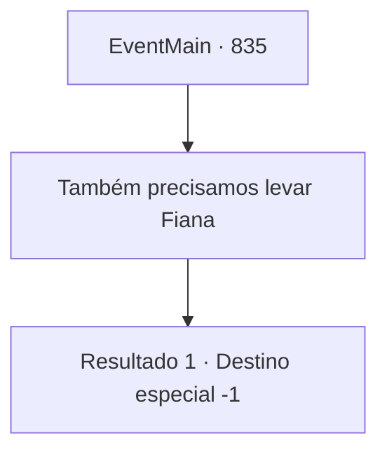

# Eventos principais · 835

[Índice da tabela](index.md) · [Índice geral](../index.md)

ID: `pt:EventMain:835` · Fonte: `EventMain4` · Versão: 1.2.47.

Mapeamento estático dos arquivos; a disponibilidade e a execução dependem do estado da run.

## Texto do evento

*Sem texto no arquivo.*

## Dados de entrada

```json
{
  "id": 835,
  "grade": 1,
  "normalGoal": "",
  "required": ""
}
```

## Mapa das escolhas



## Escolhas e resultados

### Escolha 1

Também precisamos levar Fiana

Requisitos e outros campos da escolha:

```json
{
  "required": ""
}
```

#### Resultado 1.1


 "Que tipo de esquema é esse? Já é ruim o suficiente você me levar, mas a Fiana também?!"

 Anton grita, suas veias inchadas de raiva. Rohan retruca, seu rosto se tornando sério. 

 "Cuide da sua língua ao falar da benevolência do Arcebispo."

 Com isso, Anton fecha a boca com força, suas mãos tremendo de raiva. 

 "Apenas... leve-os."

 Ele cospe. Com a ajuda de Cira, você consegue resgatar Fiana e escapar do coliseu. Uma vez lá fora, tanto você quanto Fiana questionam os eventos que acabaram de acontecer. Cira olha para você e responde. 

 "Eu estava procurando por você, e encontrei Rohan. Foi então que tive a ideia. Pedi para pegar emprestado o hábito da freira. Como eu fico?"

 Fiana expressa repetidamente sua gratidão, e Cira descarta isso com um sorriso. Ela então se aproxima de você, agarrando sua gola. 

 "Agora... não pense em se aventurar em lugares perigosos novamente. Entendeu?"

 Ela puxa sua gola para mais perto e te beija. Atrás de você, Rohan parece resmungar, talvez se sentindo culpado por usar o nome do Arcebispo em seu esquema.

Continuação registrada: [Destino especial `-1`](../destinos-especiais.md).

```json
{
  "required": "",
  "chance": "1",
  "nextEvent": -1,
  "type": 2,
  "reward": "30_4_19|15_4_2"
}
```

## Referências que chegam a este evento

- [Evento 834 · escolha 1 · resultado 4](0834.md#escolha-1)
- [Evento 834 · escolha 1 · resultado 5](0834.md#escolha-1)
