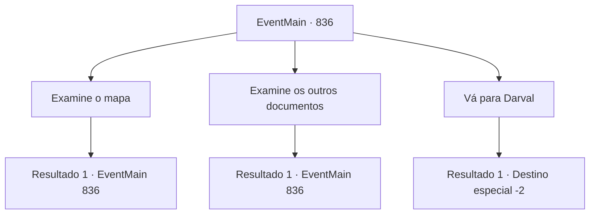

# Eventos principais · 836

[Índice da tabela](index.md) · [Índice geral](../index.md)

ID: `pt:EventMain:836` · Fonte: `EventMain4` · Versão: 1.2.47.

Mapeamento estático dos arquivos; a disponibilidade e a execução dependem do estado da run.

## Texto do evento

Você deve descobrir para onde o curioso arqueólogo Naverr foi e o que ele está procurando. Você decide ir primeiro ao laboratório de Naverr. Ao abrir a pesada porta de madeira e entrar, o cheiro de pergaminho antigo te dá as boas-vindas. Há uma mesa dentro, com vários documentos e mapas empilhados em cima. Em sua mesa pessoal há uma pintura de sua família, incluindo a filha de Naverr.

## Dados de entrada

```json
{
  "id": 836,
  "grade": 1,
  "normalGoal": "",
  "required": "13_5_0"
}
```

## Mapa das escolhas



## Escolhas e resultados

### Escolha 1

Examine o mapa

Requisitos e outros campos da escolha:

```json
{
  "required": "5_644_0"
}
```

#### Resultado 1.1

Você examina o mapa sobre a mesa. O mapa está decorado aqui e ali com o que parece ser marcas deixadas pelo próprio Naverr. As marcas se conectam para revelar caminhos para chegar a 'Ramatalio', passando por 'Darval' e a 'Selva de Andaria'.

Continuação registrada: [Evento 836](0836.md) na mesma tabela.

```json
{
  "required": "",
  "chance": "1",
  "nextEvent": 836,
  "type": 2,
  "reward": "5_644_1"
}
```

### Escolha 2

Examine os outros documentos

Requisitos e outros campos da escolha:

```json
{
  "required": "5_645_0"
}
```

#### Resultado 2.1

Você examina os documentos postados no quadro de avisos de madeira. Lendo-os, você aprende sobre a 'Lente de Éter' e o 'Disco da Lua'. De acordo com o texto, a 'Lente de Éter' era uma vez protegida pelos sacerdotes de um templo em 'Ramatalio', uma cidade antiga conhecida por adorar o Deus da Morte. No entanto, com o desaparecimento da própria cidade, o paradeiro do artefato também foi perdido. O 'Disco da Lua' é um prato circular feito de platina. Aparentemente, o disco caiu do céu, e a pessoa que o pegou considerou um presente dos Deuses, construindo um farol para comemorá-lo. O 'Disco da Lua' deve ter sido usado como espelho para refletir a luz, colocado no andar mais alto do farol. Naverr deve ter saído em uma viagem para encontrar esses dois artefatos.

Continuação registrada: [Evento 836](0836.md) na mesma tabela.

```json
{
  "required": "",
  "chance": "1",
  "nextEvent": 836,
  "type": 2,
  "reward": "5_645_1"
}
```

### Escolha 3

Vá para Darval

Requisitos e outros campos da escolha:

```json
{
  "required": "5_644_1|5_645_1"
}
```

#### Resultado 3.1

Você decide ir para a cidade de Darval. É um assentamento localizado em um vale cercado por montanhas de alturas variadas, famoso por suas maçãs e uvas de alta qualidade. Você rapidamente arruma suas coisas e sai do laboratório. Em frente à universidade, você se depara com a filha de Naverr. Seu nome é 'Rian' - você já a viu algumas vezes no laboratório, pois ela passa por lá de vez em quando. Ela é uma mulher alta com cabelos cacheados pretos - a impressão leonina lembra um pouco a de Naverr. Olhando para você com seus olhos azul safira, Rian diz. 

 "Oh. Ei, tudo bem."

 Ela está perguntando sobre Naverr. 

 "Meu pai... ele... ainda não voltou para casa. Ele deve estar muito ocupado, né? Tenho certeza de que nada aconteceu com ele, mas... Me avise quando souber de algo sobre ele."

 Ela se vira imediatamente para sair depois de terminar. Você também continua sua viagem para Darval.

Continuação registrada: [Destino especial `-2`](../destinos-especiais.md).

```json
{
  "required": "",
  "chance": "1",
  "nextEvent": -2,
  "type": 2,
  "reward": "13_5_1|0_2_1"
}
```

## Referências que chegam a este evento

- [Evento 836 · escolha 1 · resultado 1](0836.md#escolha-1)
- [Evento 836 · escolha 2 · resultado 1](0836.md#escolha-2)
