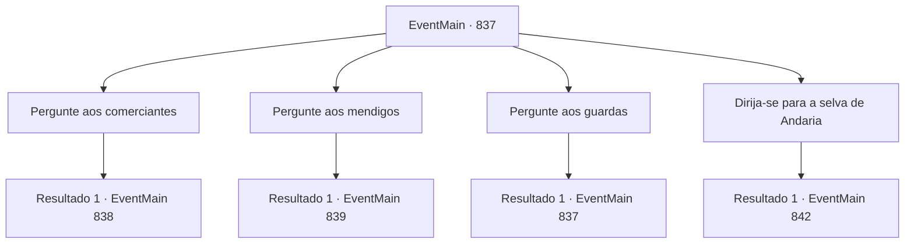

# Eventos principais · 837

[Índice da tabela](index.md) · [Índice geral](../index.md)

ID: `pt:EventMain:837` · Fonte: `EventMain4` · Versão: 1.2.47.

Mapeamento estático dos arquivos; a disponibilidade e a execução dependem do estado da run.

## Texto do evento

|drawing_darval| Você chega à cidade de Darval, o assentamento que prosperou como um cogumelo em uma montanha. As áreas próximas às muralhas da cidade estão cheias de pomares, repletos de um doce aroma. Carroças cheias de frutas entram pelas muralhas da cidade em direção ao mercado, onde já há um grande grupo de pessoas esperando para comprar as frutas. Você olha ao redor em busca de informações sobre Naverr.

## Dados de entrada

```json
{
  "id": 837,
  "grade": 1,
  "normalGoal": "",
  "required": "13_5_1|1_2_25"
}
```

## Mapa das escolhas



## Escolhas e resultados

### Escolha 1

Pergunte aos comerciantes

Requisitos e outros campos da escolha:

```json
{
  "required": "5_646_0"
}
```

#### Resultado 1.1

Você se aproxima de um mercador de frutas. Você descreve como Naverr se parece, perguntando se ele o viu. Um mercador é um mercador afinal - ele responde enrolando os dedos, fazendo um pequeno círculo. 

 "Alguma generosidade poderia melhorar minhas memórias... Digamos, 4 ouros resolveriam."


Continuação registrada: [Evento 838](0838.md) na mesma tabela.

```json
{
  "required": "",
  "chance": "1",
  "nextEvent": 838,
  "type": 2,
  "reward": "5_646_1"
}
```

### Escolha 2

Pergunte aos mendigos

Requisitos e outros campos da escolha:

```json
{
  "required": "5_647_0"
}
```

#### Resultado 2.1

Você se aproxima de um mendigo nas ruas, fingindo ser paraplégico. Você descreve como Naverr se parece, perguntando se ele o viu. O mendigo te examina de cima a baixo e sorri, revelando seus dentes sujos. 

 "Heehee... Ajude um pobre mendigo, por favor? Eu te direi tudo o que sei."

 O mendigo está pedindo 10 ouros.

Continuação registrada: [Evento 839](0839.md) na mesma tabela.

```json
{
  "required": "",
  "chance": "1",
  "nextEvent": 839,
  "type": 2,
  "reward": "5_647_1"
}
```

### Escolha 3

Pergunte aos guardas

Requisitos e outros campos da escolha:

```json
{
  "required": "5_648_0"
}
```

#### Resultado 3.1

Você se aproxima de um dos guardas na frente do portão do castelo, descrevendo como Naverr se parece e perguntando se ele o viu. O guarda pensa por um breve momento antes de abrir a boca. 

 "Oh, eu me lembro dele. Sim, sim... Bastante feroz para um arqueólogo, sim. Eu... ah, acho que ele estava viajando com um meio-elfo chamado Rosilpha, ou algo assim."


Continuação registrada: [Evento 837](0837.md) na mesma tabela.

```json
{
  "required": "",
  "chance": "1",
  "nextEvent": 837,
  "type": 2,
  "reward": "5_648_1"
}
```

### Escolha 4

Dirija-se para a selva de Andaria

Requisitos e outros campos da escolha:

```json
{
  "required": "5_646_2|5_648_1"
}
```

#### Resultado 4.1

Juntando as informações que você reuniu, você define a Patinho Flutuante da Selva de Andaria como seu próximo destino. 

 Alguns dias depois, você chega à entrada de Andaria. Seguindo o grande rio para as partes mais profundas da selva, você encontra uma cabana de madeira simples. Há um pescador, pescando em um pequeno barco amarrado nas proximidades - não um pescador humano, mas um grippli. Gripplis, os humanoides anfíbios semelhantes a sapos, são conhecidos por sua curiosidade interminável. O pescador vem falar assim que te vê. 

 "Para onde você está indo?"


Continuação registrada: [Evento 842](0842.md) na mesma tabela.

```json
{
  "required": "",
  "chance": "1",
  "nextEvent": 842,
  "type": 2,
  "reward": ""
}
```

## Referências que chegam a este evento

- [Evento 837 · escolha 3 · resultado 1](0837.md#escolha-3)
- [Evento 838 · escolha 1 · resultado 1](0838.md#escolha-1)
- [Evento 838 · escolha 2 · resultado 1](0838.md#escolha-2)
- [Evento 838 · escolha 4 · resultado 1](0838.md#escolha-4)
- [Evento 838 · escolha 5 · resultado 1](0838.md#escolha-5)
- [Evento 838 · escolha 5 · resultado 3](0838.md#escolha-5)
- [Evento 839 · escolha 5 · resultado 1](0839.md#escolha-5)
- [Evento 839 · escolha 5 · resultado 2](0839.md#escolha-5)
- [Evento 839 · escolha 5 · resultado 3](0839.md#escolha-5)
- [Evento 840 · escolha 1 · resultado 1](0840.md#escolha-1)
- [Evento 840 · escolha 1 · resultado 2](0840.md#escolha-1)
- [Evento 840 · escolha 1 · resultado 3](0840.md#escolha-1)
- [Evento 840 · escolha 1 · resultado 4](0840.md#escolha-1)
- [Evento 840 · escolha 3 · resultado 1](0840.md#escolha-3)
- [Evento 841 · escolha 1 · resultado 1](0841.md#escolha-1)
- [Evento 841 · escolha 2 · resultado 1](0841.md#escolha-2)
