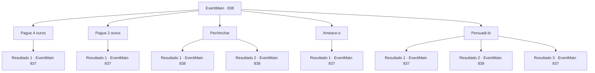

# Eventos principais · 838

[Índice da tabela](index.md) · [Índice geral](../index.md)

ID: `pt:EventMain:838` · Fonte: `EventMain4` · Versão: 1.2.47.

Mapeamento estático dos arquivos; a disponibilidade e a execução dependem do estado da run.

## Texto do evento

*Sem texto no arquivo.*

## Dados de entrada

```json
{
  "id": 838,
  "grade": 1,
  "normalGoal": "",
  "required": ""
}
```

## Mapa das escolhas



## Escolhas e resultados

### Escolha 1

Pague 4 ouros

Requisitos e outros campos da escolha:

```json
{
  "required": "18_649_1|1_4_4"
}
```

#### Resultado 1.1

Você paga o comerciante, comprando informações dele. Ele responde olhando para cima, como se estivesse lembrando de algo. 

 "Não tenho certeza para onde esse tal de Naverr foi, mas lembro que havia um guia halfling o acompanhando. Alguém da... Patinho Flutuante? Por que você não vai lá - é um lugar na Selva de Andaria."


Continuação registrada: [Evento 837](0837.md) na mesma tabela.

```json
{
  "required": "",
  "chance": "1",
  "nextEvent": 837,
  "type": 2,
  "reward": "0_4_-4|5_646_2"
}
```

### Escolha 2

Pague 2 ouros

Requisitos e outros campos da escolha:

```json
{
  "required": "5_649_1|1_4_2"
}
```

#### Resultado 2.1

Você paga o comerciante, comprando informações dele. Ele responde olhando para cima, como se estivesse lembrando de algo. 

 "Não tenho certeza para onde esse tal de Naverr foi, mas lembro que havia um guia halfling o acompanhando. Alguém da... Patinho Flutuante? Por que você não vai lá - é um lugar na Selva de Andaria."


Continuação registrada: [Evento 837](0837.md) na mesma tabela.

```json
{
  "required": "",
  "chance": "1",
  "nextEvent": 837,
  "type": 2,
  "reward": "0_4_-2|5_646_2"
}
```

### Escolha 3

Pechinchar

Requisitos e outros campos da escolha:

```json
{
  "required": "5_649_0"
}
```

#### Resultado 3.1

Você tenta pechinchar com o comerciante, ao que ele concorda com a cabeça. 

 "Bem... Acho que posso fazer isso. 2 ouros, então."


Continuação registrada: [Evento 838](0838.md) na mesma tabela.

```json
{
  "required": "",
  "chance": "1|0_12_1",
  "nextEvent": 838,
  "type": 0,
  "reward": "5_649_1"
}
```

#### Resultado 3.2

Você tenta pechinchar com o comerciante, ao que ele balança a cabeça em desacordo. 

 "Olha, eu não sou o desesperado aqui. 4 ouros, pegue ou deixe."


Continuação registrada: [Evento 838](0838.md) na mesma tabela.

```json
{
  "required": "",
  "chance": "8",
  "nextEvent": 838,
  "type": 1,
  "reward": "5_649_2"
}
```

### Escolha 4

Ameace-o

Requisitos e outros campos da escolha:

```json
{
  "required": ""
}
```

#### Resultado 4.1

Você examina as prateleiras, notando as maçãs maduras em exposição. Você ameaça o comerciante dizendo que seria uma pena se alguém esmagasse essas maçãs em pedaços. Ele responde cuspindo no chão. 

 "Ah, maldito. Você tinha que estragar o meu dia, né? Tudo bem, tudo bem. Esse tal de Naverr? Ele deve ter ido para a Selva de Andaria. Algo sobre aguapés..."


Continuação registrada: [Evento 837](0837.md) na mesma tabela.

```json
{
  "required": "",
  "chance": "1",
  "nextEvent": 837,
  "type": 2,
  "reward": "0_3_-1|5_646_2"
}
```

### Escolha 5

Persuadi-lo

Requisitos e outros campos da escolha:

```json
{
  "required": "5_704_0"
}
```

#### Resultado 5.1

Você pergunta ao comerciante informações sobre Naverr. O comerciante olha para você com pena e diz. 

 "Ah... Não tenho certeza para onde esse tal de Naverr foi, mas lembro que havia um guia halfling o acompanhando. Alguém da... Patinho Flutuante? Por que você não vai até lá - é um lugar na Selva de Andaria."


Continuação registrada: [Evento 837](0837.md) na mesma tabela.

```json
{
  "required": "",
  "chance": "1|0_12_1",
  "nextEvent": 837,
  "type": 0,
  "reward": "5_646_2"
}
```

#### Resultado 5.2

Você pergunta ao comerciante sobre informações sobre Naverr. No entanto, o comerciante balança a cabeça. 

 "Eu sou um comerciante. Se você quer algo, você tem que pagar por isso."


Continuação registrada: [Evento 838](0838.md) na mesma tabela.

```json
{
  "required": "",
  "chance": "15",
  "nextEvent": 838,
  "type": 1,
  "reward": "5_704_1"
}
```

#### Resultado 5.3

Você pergunta ao comerciante sobre informações sobre Naverr. O comerciante olha para você com pena e diz. 

 "Você tem uma boa aparência, então vou te contar. Não tenho certeza para onde esse tal de Naverr foi, mas lembro que havia um guia halfling o acompanhando. Alguém do... o Patinho Flutuante? Por que você não vai lá - é um lugar na Selva de Andaria."


Continuação registrada: [Evento 837](0837.md) na mesma tabela.

```json
{
  "required": "1_3_15",
  "chance": "1|0_12_1",
  "nextEvent": 837,
  "type": 0,
  "reward": "5_646_2"
}
```

## Referências que chegam a este evento

- [Evento 837 · escolha 1 · resultado 1](0837.md#escolha-1)
- [Evento 838 · escolha 3 · resultado 1](0838.md#escolha-3)
- [Evento 838 · escolha 3 · resultado 2](0838.md#escolha-3)
- [Evento 838 · escolha 5 · resultado 2](0838.md#escolha-5)
