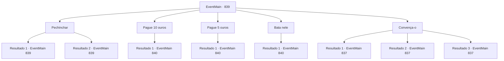

# Eventos principais · 839

[Índice da tabela](index.md) · [Índice geral](../index.md)

ID: `pt:EventMain:839` · Fonte: `EventMain4` · Versão: 1.2.47.

Mapeamento estático dos arquivos; a disponibilidade e a execução dependem do estado da run.

## Texto do evento

*Sem texto no arquivo.*

## Dados de entrada

```json
{
  "id": 839,
  "grade": 1,
  "normalGoal": "",
  "required": ""
}
```

## Mapa das escolhas



## Escolhas e resultados

### Escolha 1

Pechinchar

Requisitos e outros campos da escolha:

```json
{
  "required": "5_650_0"
}
```

#### Resultado 1.1

Você consegue pechinchar com o mendigo. Ele sorri, como se estivesse tentando te encher de elogios. 

 "Oh, bem, bem... Eu realmente preferiria ter os 10 ouros, mas... Se você insistir, eu te conto tudo o que sei por 5."


Continuação registrada: [Evento 839](0839.md) na mesma tabela.

```json
{
  "required": "",
  "chance": "1|0_12_1",
  "nextEvent": 839,
  "type": 0,
  "reward": "5_650_1"
}
```

#### Resultado 1.2

Você tenta pechinchar com o mendigo, mas ele começa a implorar em resposta. 

 "Eh... eu também tenho uma cota, sabe. E... você realmente vai negociar preços com um mendigo de rua...?"


Continuação registrada: [Evento 839](0839.md) na mesma tabela.

```json
{
  "required": "",
  "chance": "15",
  "nextEvent": 839,
  "type": 1,
  "reward": "5_650_2"
}
```

### Escolha 2

Pague 10 ouros

Requisitos e outros campos da escolha:

```json
{
  "required": "18_650_1|1_4_10"
}
```

#### Resultado 2.1

Você paga o mendigo. Então um milagre acontece - o mendigo 'paraplégico' de repente se levanta, joga sua manta em seu rosto e foge. Você o persegue pelos becos estreitos, encontrando no meio do caminho uma pequena gangue de bandidos. Eles imediatamente franzem a testa, tentando intimidá-lo. 

 "Hein? Quem diabos é você? Desapareça!"


Continuação registrada: [Evento 840](0840.md) na mesma tabela.

```json
{
  "required": "",
  "chance": "1",
  "nextEvent": 840,
  "type": 2,
  "reward": "0_4_-10|5_651_1"
}
```

### Escolha 3

Pague 5 ouros

Requisitos e outros campos da escolha:

```json
{
  "required": "5_650_1|1_4_5"
}
```

#### Resultado 3.1

Você paga o mendigo. Então um milagre acontece - o mendigo 'paraplégico' de repente se levanta, joga sua manta em seu rosto e foge. Você o persegue pelos becos estreitos, encontrando no meio do caminho uma pequena gangue de bandidos. Eles imediatamente franzem a testa, tentando intimidá-lo. 

 "Hein? Quem diabos é você? Desapareça!"


Continuação registrada: [Evento 840](0840.md) na mesma tabela.

```json
{
  "required": "",
  "chance": "1",
  "nextEvent": 840,
  "type": 2,
  "reward": "0_4_-5|5_651_1"
}
```

### Escolha 4

Bata nele

Requisitos e outros campos da escolha:

```json
{
  "required": "2_3_15"
}
```

#### Resultado 4.1

Você fecha os punhos e começa a agredir o mendigo. Então um milagre acontece - o mendigo 'paraplégico' de repente se levanta, joga sua manta em seu rosto e foge. Você o persegue pelos becos estreitos, encontrando um pequeno grupo de bandidos no meio do caminho. Eles imediatamente franzem a testa, tentando te intimidar. 

 "Hein? Quem diabos é você? Desapareça!"


Continuação registrada: [Evento 840](0840.md) na mesma tabela.

```json
{
  "required": "",
  "chance": "1",
  "nextEvent": 840,
  "type": 2,
  "reward": "0_3_-1"
}
```

### Escolha 5

Convença-o

Requisitos e outros campos da escolha:

```json
{
  "required": ""
}
```

#### Resultado 5.1

Você gentilmente pede informações ao mendigo. Ele responde, coçando a nuca. 

 "Eu... ah, para ser honesto, eu não sei de nada... Sério."

 Ele então volta a mendigar, o que significa que agora você terá que encontrar outra maneira de obter informações.

Continuação registrada: [Evento 837](0837.md) na mesma tabela.

```json
{
  "required": "",
  "chance": "1|0_12_1",
  "nextEvent": 837,
  "type": 0,
  "reward": ""
}
```

#### Resultado 5.2

Você gentilmente pede informações ao mendigo. Então, o mendigo foge para os becos. Você terá que encontrar outra maneira de obter informações.

Continuação registrada: [Evento 837](0837.md) na mesma tabela.

```json
{
  "required": "",
  "chance": "15",
  "nextEvent": 837,
  "type": 1,
  "reward": ""
}
```

#### Resultado 5.3

Você gentilmente pede informações ao mendigo. Ele responde, coçando a nuca. 

 "Eu... ah, para ser honesto, eu não sei de nada... Sério."

 Ele então volta a mendigar, o que significa que agora você terá que encontrar outra maneira de obter informações.

Continuação registrada: [Evento 837](0837.md) na mesma tabela.

```json
{
  "required": "1_3_15",
  "chance": "1|0_12_1",
  "nextEvent": 837,
  "type": 0,
  "reward": ""
}
```

## Referências que chegam a este evento

- [Evento 837 · escolha 2 · resultado 1](0837.md#escolha-2)
- [Evento 839 · escolha 1 · resultado 1](0839.md#escolha-1)
- [Evento 839 · escolha 1 · resultado 2](0839.md#escolha-1)
