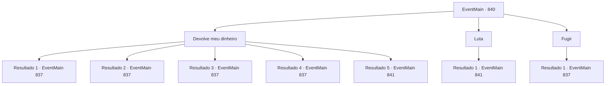

# Eventos principais · 840

[Índice da tabela](index.md) · [Índice geral](../index.md)

ID: `pt:EventMain:840` · Fonte: `EventMain4` · Versão: 1.2.47.

Mapeamento estático dos arquivos; a disponibilidade e a execução dependem do estado da run.

## Texto do evento

*Sem texto no arquivo.*

## Dados de entrada

```json
{
  "id": 840,
  "grade": 1,
  "normalGoal": "",
  "required": ""
}
```

## Mapa das escolhas



## Escolhas e resultados

### Escolha 1

Devolve meu dinheiro

Requisitos e outros campos da escolha:

```json
{
  "required": "5_651_1"
}
```

#### Resultado 1.1

Você os intimida ainda mais, exigindo que o mendigo devolva o ouro que ele roubou. Os bandidos ficam em silêncio por um segundo, antes de fazerem o mendigo devolver o ouro. 

 "Eu... Hum, eu realmente não tenho nada para te dizer, então acho que vou devolver isso..."

 Você arranca o ouro das mãos do mendigo e sai do beco.

Continuação registrada: [Evento 837](0837.md) na mesma tabela.

```json
{
  "required": "18_650_1|21_1_3",
  "chance": "1|0_12_1",
  "nextEvent": 837,
  "type": 0,
  "reward": "0_4_10"
}
```

#### Resultado 1.2

Você os intimida ainda mais, exigindo que o mendigo devolva o ouro que ele roubou. Os bandidos ficam em silêncio por um segundo, antes de fazerem o mendigo devolver o ouro. 

 "Eu... Hum, eu realmente não tenho nada para te dizer, então acho que vou devolver isso..."

 Você arranca o ouro das mãos do mendigo e sai do beco.

Continuação registrada: [Evento 837](0837.md) na mesma tabela.

```json
{
  "required": "5_650_1|21_1_3",
  "chance": "1|0_12_1",
  "nextEvent": 837,
  "type": 0,
  "reward": "0_4_5"
}
```

#### Resultado 1.3

Você os intimida ainda mais, exigindo que o mendigo devolva o ouro que ele roubou. Os bandidos ficam em silêncio por um segundo, antes de fazerem o mendigo devolver o ouro. 

 "Eu... Hum, eu realmente não tenho nada para te dizer, então acho que vou devolver isso..."

 Você arranca o ouro das mãos do mendigo e sai do beco.

Continuação registrada: [Evento 837](0837.md) na mesma tabela.

```json
{
  "required": "18_650_1|20_1_3",
  "chance": "1",
  "nextEvent": 837,
  "type": 2,
  "reward": "0_4_10"
}
```

#### Resultado 1.4

Você os intimida ainda mais, exigindo que o mendigo devolva o ouro que ele roubou. Os bandidos ficam em silêncio por um segundo, antes de fazerem o mendigo devolver o ouro. 

 "Eu... Hum, eu realmente não tenho nada para te dizer, então acho que vou devolver isso..."

 Você arranca o ouro das mãos do mendigo e sai do beco.

Continuação registrada: [Evento 837](0837.md) na mesma tabela.

```json
{
  "required": "5_650_1|20_1_3",
  "chance": "1",
  "nextEvent": 837,
  "type": 2,
  "reward": "0_4_5"
}
```

#### Resultado 1.5

Os bandidos zombam em resposta, brandindo suas adagas para você. 

 "Você não parece entender a situação em que está agora. Escute bem, certo? Vamos te ensinar isso uma vez."

 Os bandidos avançam em sua direção, para tirar algo mais valioso do que alguns ouros de você.

Continuação registrada: [Evento 841](0841.md) na mesma tabela.

```json
{
  "required": "21_1_3",
  "chance": "20",
  "nextEvent": 841,
  "type": 1,
  "reward": "6_3_2",
  "place": 4
}
```

### Escolha 2

Luta

Requisitos e outros campos da escolha:

```json
{
  "required": ""
}
```

#### Resultado 2.1

Os bandidos zombam em resposta, brandindo suas adagas para você. 

 "Você não parece entender a situação em que está agora. Escute bem, certo? Vamos te ensinar isso uma vez."

 Os bandidos avançam em sua direção, para tirar algo mais valioso do que alguns ouros de você.

Continuação registrada: [Evento 841](0841.md) na mesma tabela.

```json
{
  "required": "",
  "chance": "1",
  "nextEvent": 841,
  "type": 2,
  "reward": "6_3_2",
  "place": 4
}
```

### Escolha 3

Fugir

Requisitos e outros campos da escolha:

```json
{
  "required": ""
}
```

#### Resultado 3.1

Você foge dos bandidos. Felizmente, eles não te perseguem para fora do beco.

Continuação registrada: [Evento 837](0837.md) na mesma tabela.

```json
{
  "required": "",
  "chance": "1",
  "nextEvent": 837,
  "type": 2,
  "reward": ""
}
```

## Referências que chegam a este evento

- [Evento 839 · escolha 2 · resultado 1](0839.md#escolha-2)
- [Evento 839 · escolha 3 · resultado 1](0839.md#escolha-3)
- [Evento 839 · escolha 4 · resultado 1](0839.md#escolha-4)
