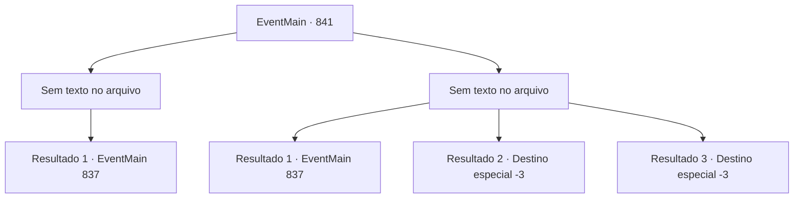

# Eventos principais · 841

[Índice da tabela](index.md) · [Índice geral](../index.md)

ID: `pt:EventMain:841` · Fonte: `EventMain4` · Versão: 1.2.47.

Mapeamento estático dos arquivos; a disponibilidade e a execução dependem do estado da run.

## Texto do evento

*Sem texto no arquivo.*

## Dados de entrada

```json
{
  "id": 841,
  "grade": 1,
  "normalGoal": "",
  "required": ""
}
```

## Mapa das escolhas



## Escolhas e resultados

### Escolha 1

*Sem texto no arquivo; o papel dessa opção depende da interface do jogo.*

Requisitos e outros campos da escolha:

```json
{
  "required": ""
}
```

#### Resultado 1.1


 "Lamentamos...!!"

 Você ensina uma lição aos bandidos com sua força. Eles ficam tão impressionados com seus ensinamentos que voluntariamente desistem de seus pertences para você. Você aceita feliz a 'doação' deles, para ajudar em sua jornada para encontrar Naverr. Eles continuam se curvando para você antes de fugir.

Continuação registrada: [Evento 837](0837.md) na mesma tabela.

```json
{
  "required": "",
  "chance": "1",
  "nextEvent": 837,
  "type": 2,
  "reward": "0_4_50|3_27_1"
}
```

### Escolha 2

*Sem texto no arquivo; o papel dessa opção depende da interface do jogo.*

Requisitos e outros campos da escolha:

```json
{
  "required": ""
}
```

#### Resultado 2.1

Você foge apressadamente do beco. Eles te perseguem por alguns minutos antes de desistirem e recuarem para seu esconderijo.

Continuação registrada: [Evento 837](0837.md) na mesma tabela.

```json
{
  "required": "1_0_2|1_1_2",
  "chance": "1",
  "nextEvent": 837,
  "type": 2,
  "reward": "0_0_-1|0_1_-1"
}
```

#### Resultado 2.2

Uma das adagas dos bandidos encontra seu caminho em sua garganta. Até os próprios bandidos estão surpresos. 

 "Huh...? Droga, meu azar..."

 "Eu te disse! Quando eles respondem violentamente, só queremos assustá-los! Ugh..."

 Sua conversa é a última coisa que você ouve antes de sua consciência desaparecer.

Continuação registrada: [Destino especial `-3`](../destinos-especiais.md).

```json
{
  "required": "2_0_2",
  "chance": "1",
  "nextEvent": -3,
  "type": 2,
  "reward": "0_0_-1|0_1_-1"
}
```

#### Resultado 2.3

Uma das adagas dos bandidos encontra seu caminho em sua garganta. Até os próprios bandidos estão surpresos. 

 "Huh...? Droga, meu azar..."

 "Eu te disse! Quando eles respondem violentamente, só queremos assustá-los! Ugh..."

 Sua conversa é a última coisa que você ouve antes de sua consciência desaparecer.

Continuação registrada: [Destino especial `-3`](../destinos-especiais.md).

```json
{
  "required": "2_1_2",
  "chance": "1",
  "nextEvent": -3,
  "type": 2,
  "reward": "0_0_-1|0_1_-1"
}
```

## Referências que chegam a este evento

- [Evento 840 · escolha 1 · resultado 5](0840.md#escolha-1)
- [Evento 840 · escolha 2 · resultado 1](0840.md#escolha-2)
