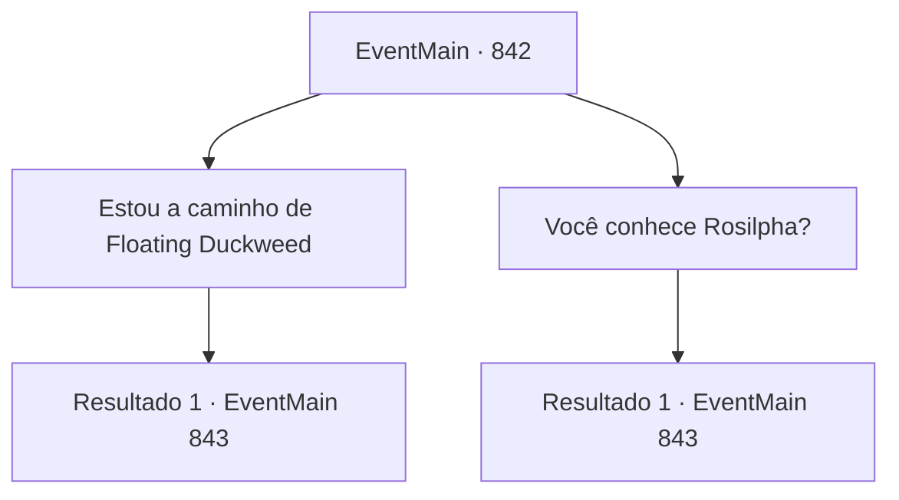

# Eventos principais · 842

[Índice da tabela](index.md) · [Índice geral](../index.md)

ID: `pt:EventMain:842` · Fonte: `EventMain4` · Versão: 1.2.47.

Mapeamento estático dos arquivos; a disponibilidade e a execução dependem do estado da run.

## Texto do evento

*Sem texto no arquivo.*

## Dados de entrada

```json
{
  "id": 842,
  "grade": 1,
  "normalGoal": "",
  "required": ""
}
```

## Mapa das escolhas



## Escolhas e resultados

### Escolha 1

Estou a caminho de Floating Duckweed

Requisitos e outros campos da escolha:

```json
{
  "required": ""
}
```

#### Resultado 1.1

Você diz ao grippli que está indo para Floating Duckweed. O pescador responde com um coaxar, expandindo brevemente suas bochechas. 

 "Eh, o barco é um pouco pequeno, mas suba. Vou te levar para minha cidade."

 Ele move o barco, tecido com folhas de banana, em sua direção. Você viaja de barco com o pescador para a cidade dos gripplis. |drawing_floatingDuckweed| Construída em meio à floresta tropical escaldante, toda a cidade é uma aglomeração de folhas de lótus colossais e gigantescas duckweeds, grandes o suficiente para suportar humanoides. As casas dos gripplis são construídas em cima dessas folhas. Um dos sentinelas grippli desce pelas raízes de lótus, perguntando quem você é.

Continuação registrada: [Evento 843](0843.md) na mesma tabela.

```json
{
  "required": "",
  "chance": "1",
  "nextEvent": 843,
  "type": 2,
  "reward": ""
}
```

### Escolha 2

Você conhece Rosilpha?

Requisitos e outros campos da escolha:

```json
{
  "required": ""
}
```

#### Resultado 2.1

Você diz ao pescador que está procurando por alguém chamado 'Rosilpha'. O pescador responde com um coaxar, expandindo brevemente suas bochechas. 

 "Rosilpha... Sim, Rosilpha eu conheço. Suba. Vou te levar para minha cidade."

 Ele move o barco, tecido com folhas de banana, em sua direção. Você viaja no barco com o pescador até a cidade dos gripplis. |drawing_floatingDuckweed| Construída em meio à floresta tropical escaldante, a cidade inteira é uma aglomeração de folhas de lótus colossais e gigantescas ervas aquáticas, grandes o suficiente para suportar humanoides. As casas dos gripplis são construídas em cima dessas folhas. Um dos sentinelas gripplis desce pelas raízes de lótus, perguntando quem você é.

Continuação registrada: [Evento 843](0843.md) na mesma tabela.

```json
{
  "required": "",
  "chance": "1",
  "nextEvent": 843,
  "type": 2,
  "reward": ""
}
```

## Referências que chegam a este evento

- [Evento 837 · escolha 4 · resultado 1](0837.md#escolha-4)
