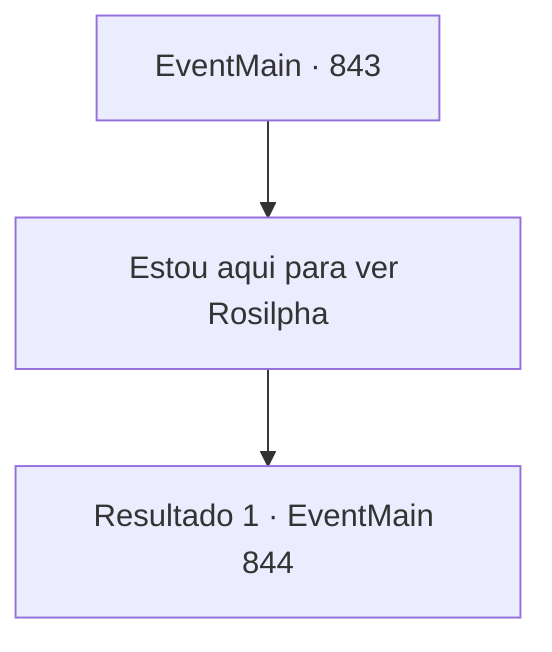

# Eventos principais · 843

[Índice da tabela](index.md) · [Índice geral](../index.md)

ID: `pt:EventMain:843` · Fonte: `EventMain4` · Versão: 1.2.47.

Mapeamento estático dos arquivos; a disponibilidade e a execução dependem do estado da run.

## Texto do evento

*Sem texto no arquivo.*

## Dados de entrada

```json
{
  "id": 843,
  "grade": 1,
  "normalGoal": "",
  "required": ""
}
```

## Mapa das escolhas



## Escolhas e resultados

### Escolha 1

Estou aqui para ver Rosilpha

Requisitos e outros campos da escolha:

```json
{
  "required": ""
}
```

#### Resultado 1.1

Você conta seus negócios no Floating Duckweed. Os gripplis todos dão risada, antes que um deles limpe a garganta e continue. 

 "Aquele wannabe-Grippli? Você o encontrará em algum lugar perto dos cantos desta cidade. Ele deve estar praticando seu arco e flecha... contra um boneco! Haha!"


Continuação registrada: [Evento 844](0844.md) na mesma tabela.

```json
{
  "required": "",
  "chance": "1",
  "nextEvent": 844,
  "type": 2,
  "reward": ""
}
```

## Referências que chegam a este evento

- [Evento 842 · escolha 1 · resultado 1](0842.md#escolha-1)
- [Evento 842 · escolha 2 · resultado 1](0842.md#escolha-2)
