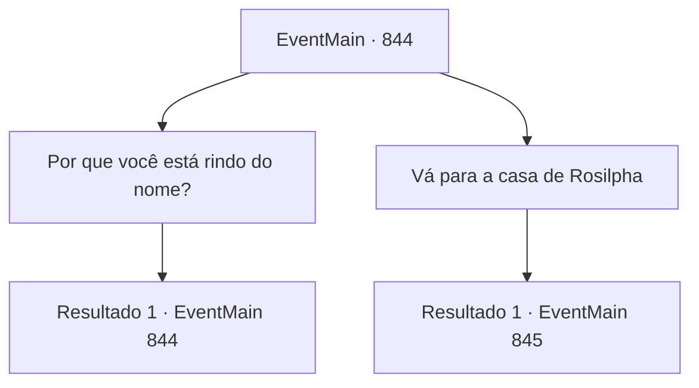

# Eventos principais · 844

[Índice da tabela](index.md) · [Índice geral](../index.md)

ID: `pt:EventMain:844` · Fonte: `EventMain4` · Versão: 1.2.47.

Mapeamento estático dos arquivos; a disponibilidade e a execução dependem do estado da run.

## Texto do evento

*Sem texto no arquivo.*

## Dados de entrada

```json
{
  "id": 844,
  "grade": 1,
  "normalGoal": "",
  "required": ""
}
```

## Mapa das escolhas



## Escolhas e resultados

### Escolha 1

Por que você está rindo do nome?

Requisitos e outros campos da escolha:

```json
{
  "required": "5_652_0"
}
```

#### Resultado 1.1

Você os questiona mais sobre suas reações ao nome 'Rosilpha'. O guarda grippli dá de ombros e responde. 

 "Como você se sentiria se encontrasse um goblin que se considerasse humano? A mesma coisa."

 Ele acena displicentemente com as mãos para você, pedindo para sair.

Continuação registrada: [Evento 844](0844.md) na mesma tabela.

```json
{
  "required": "",
  "chance": "1",
  "nextEvent": 844,
  "type": 2,
  "reward": "5_652_1"
}
```

### Escolha 2

Vá para a casa de Rosilpha

Requisitos e outros campos da escolha:

```json
{
  "required": ""
}
```

#### Resultado 2.1

Você encontra uma erva-pata separada das outras nos arredores remotos da cidade. Lá, você encontra uma casa tecida com gramas enormes, e alguns bonecos de treinamento com flechas cravadas neles. Você encontra um halfling lá, atirando flechas nos bonecos. Você desembarca do barco e se aproxima do halfling. 

 "Hmm? Ah, um forasteiro. Espere. Estou ocupado no momento..."


Continuação registrada: [Evento 845](0845.md) na mesma tabela.

```json
{
  "required": "",
  "chance": "1",
  "nextEvent": 845,
  "type": 2,
  "reward": ""
}
```

## Referências que chegam a este evento

- [Evento 843 · escolha 1 · resultado 1](0843.md#escolha-1)
- [Evento 844 · escolha 1 · resultado 1](0844.md#escolha-1)
