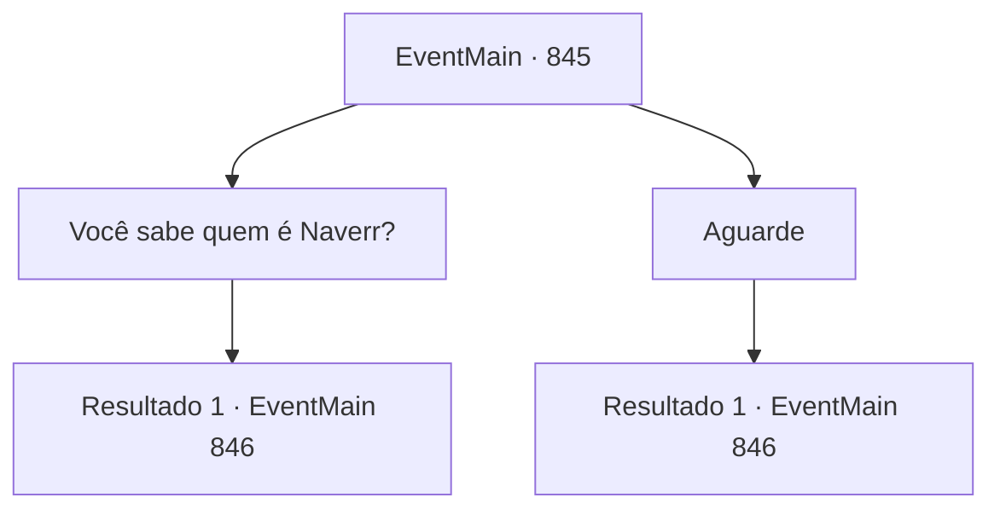

# Eventos principais · 845

[Índice da tabela](index.md) · [Índice geral](../index.md)

ID: `pt:EventMain:845` · Fonte: `EventMain4` · Versão: 1.2.47.

Mapeamento estático dos arquivos; a disponibilidade e a execução dependem do estado da run.

## Texto do evento

*Sem texto no arquivo.*

## Dados de entrada

```json
{
  "id": 845,
  "grade": 1,
  "normalGoal": "",
  "required": ""
}
```

## Mapa das escolhas



## Escolhas e resultados

### Escolha 1

Você sabe quem é Naverr?

Requisitos e outros campos da escolha:

```json
{
  "required": ""
}
```

#### Resultado 1.1

Você não espera, imediatamente bombardeando-o com perguntas. O halfling suspira e faz um gesto para que você fale dentro de sua casa. 

 "Sente-se."

 Rosilpha puxa uma cadeira vazia e prepara um chá. O chá tem um leve cheiro de chuva. 

 "Eu sou Rosilpha, do Floating Duckweed. Ele não parece em nada um grippli, mas se autodenomina assim."|drawing_rosilpa| Então, ele pergunta quem você é. Você diz a ele que é aprendiz de Naverr. Toda a conversa complicada sobre civilização como a Universidade de Brikkalua e o Departamento de Arqueologia não o alcança. 

 "Ah, entendi. Eu me aventurei nas ruínas de Ramatalia com ele uma vez. Foi uma expedição emocionante, descobrindo a Lente de Éter, enterrada sob as areias por éons. Enfim, que negócio um aprendiz de Naverr poderia ter comigo?"


Continuação registrada: [Evento 846](0846.md) na mesma tabela.

```json
{
  "required": "",
  "chance": "1",
  "nextEvent": 846,
  "type": 2,
  "reward": ""
}
```

### Escolha 2

Aguarde

Requisitos e outros campos da escolha:

```json
{
  "required": ""
}
```

#### Resultado 2.1

Você observa Rosilpha praticar por alguns minutos. A flecha voa casualmente passando pelo boneco, mas no segundo seguinte, uma flecha magicamente aparece no boneco. Rosilpha mostra um pequeno sinal de contentamento, limpa a garganta e se vira para você. 

 "A Flecha magia de Rosilpha. A mesma que estou praticando agora. Engana seus oponentes, para que não possam dizer qual alvo estou mirando. De qualquer forma - estou fazendo meu convidado esperar muito tempo. Entre, entre."

 Rosilpha puxa uma cadeira vazia e prepara um chá. O chá tem um leve cheiro de chuva. 

 "Eu sou Rosilpha, do Patinho Flutuante. Um 'grippli', nascido e criado nesta cidade, aprovado pelo ancião da cidade também."|drawing_rosilpa| Ele não parece em nada com um grippli, mas se autodenomina assim. Então, ele pergunta quem você é. Você diz a ele que é aprendiz de Naverr. Toda a conversa complicada da civilização como a Universidade de Brikkalua e o Departamento de Arqueologia não o alcança. 

 "Ah, entendi. Eu me aventurei nas ruínas de Ramatalia com ele uma vez. Foi uma expedição emocionante, descobrindo a Lente de Éter, enterrada sob as areias por éons. Enfim, que negócio um aprendiz de Naverr poderia ter comigo?"


Continuação registrada: [Evento 846](0846.md) na mesma tabela.

```json
{
  "required": "",
  "chance": "1",
  "nextEvent": 846,
  "type": 2,
  "reward": ""
}
```

## Referências que chegam a este evento

- [Evento 844 · escolha 2 · resultado 1](0844.md#escolha-2)
