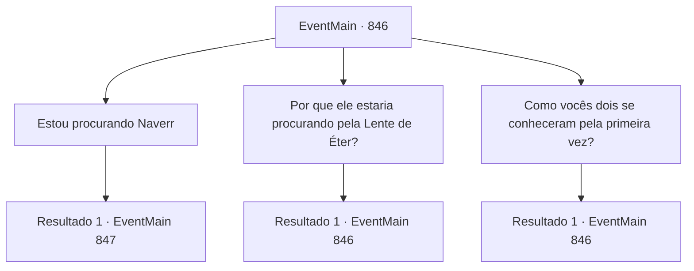

# Eventos principais · 846

[Índice da tabela](index.md) · [Índice geral](../index.md)

ID: `pt:EventMain:846` · Fonte: `EventMain4` · Versão: 1.2.47.

Mapeamento estático dos arquivos; a disponibilidade e a execução dependem do estado da run.

## Texto do evento

*Sem texto no arquivo.*

## Dados de entrada

```json
{
  "id": 846,
  "grade": 1,
  "normalGoal": "",
  "required": ""
}
```

## Mapa das escolhas



## Escolhas e resultados

### Escolha 1

Estou procurando Naverr

Requisitos e outros campos da escolha:

```json
{
  "required": "-1|5_668_1|5_669_1"
}
```

#### Resultado 1.1

Rosilpha responde dizendo que depois que encontraram a Lente Ether, os dois se separaram na Selva de Andaria. Ele acrescenta que na época, ele pensou que Naverr voltaria imediatamente para a universidade. 

 "Hm... Tenho certeza de que foi isso que ele me disse. Parece estranho o suficiente. Vou te ajudar a procurá-lo. Siga-me."


Continuação registrada: [Evento 847](0847.md) na mesma tabela.

```json
{
  "required": "",
  "chance": "1",
  "nextEvent": 847,
  "type": 2,
  "reward": ""
}
```

### Escolha 2

Por que ele estaria procurando pela Lente de Éter?

Requisitos e outros campos da escolha:

```json
{
  "required": "5_668_0"
}
```

#### Resultado 2.1

Rosilpha inclina a cabeça em resposta. 

 "Você deveria ser o aprendiz dele, não é? Parece que está perguntando para a pessoa errada. Bem... pelo que me lembro, o que o motiva a procurar por todos esses artefatos é... pura sede por conhecimento acadêmico."


Continuação registrada: [Evento 846](0846.md) na mesma tabela.

```json
{
  "required": "",
  "chance": "1",
  "nextEvent": 846,
  "type": 2,
  "reward": "5_668_1"
}
```

### Escolha 3

Como vocês dois se conheceram pela primeira vez?

Requisitos e outros campos da escolha:

```json
{
  "required": "5_669_0"
}
```

#### Resultado 3.1


 "Ele se perdeu na selva. Parecia que foi atacado por uma horda de goblins macacos. Por isso o ajudei. Para que ele possa terminar sua aventura."

 Ele dá um gole em seu chá e continua. Rosilpha diz que ele quer que os gripplis o reconheçam oficialmente como membro da comunidade, e que se ele pudesse ajudar na busca de Naverr por artefatos antigos, os moradores da cidade conhecerão suas habilidades. 

 "Bem... pelo que sinto, tem sido insuficiente até agora. Mas tenho certeza de que um dia terão que admitir minhas façanhas."


Continuação registrada: [Evento 846](0846.md) na mesma tabela.

```json
{
  "required": "",
  "chance": "1",
  "nextEvent": 846,
  "type": 2,
  "reward": "5_669_1"
}
```

## Referências que chegam a este evento

- [Evento 845 · escolha 1 · resultado 1](0845.md#escolha-1)
- [Evento 845 · escolha 2 · resultado 1](0845.md#escolha-2)
- [Evento 846 · escolha 2 · resultado 1](0846.md#escolha-2)
- [Evento 846 · escolha 3 · resultado 1](0846.md#escolha-3)
