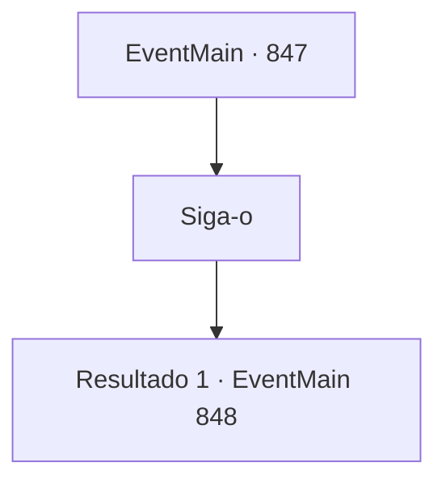

# Eventos principais · 847

[Índice da tabela](index.md) · [Índice geral](../index.md)

ID: `pt:EventMain:847` · Fonte: `EventMain4` · Versão: 1.2.47.

Mapeamento estático dos arquivos; a disponibilidade e a execução dependem do estado da run.

## Texto do evento

*Sem texto no arquivo.*

## Dados de entrada

```json
{
  "id": 847,
  "grade": 1,
  "normalGoal": "",
  "required": ""
}
```

## Mapa das escolhas



## Escolhas e resultados

### Escolha 1

Siga-o

Requisitos e outros campos da escolha:

```json
{
  "required": ""
}
```

#### Resultado 1.1

Rosilpha te leva até uma cabana construída no topo da maior e mais alta folha de lótus da cidade. Ele entra na cabana, cumprimentando um velho grippli. 

 "Respeitado Ancião, tenho negócios fora da cidade e devo me ausentar brevemente."

 O grippli mais velho ouve Rosilpha, vira seu olhar para você e faz uma pergunta. 

 "Hm, hm... Então me diga, jovem, para onde ele poderia ter ido? Um arqueólogo... deve estar em busca de algo, certo?"


Continuação registrada: [Evento 848](0848.md) na mesma tabela.

```json
{
  "required": "",
  "chance": "1",
  "nextEvent": 848,
  "type": 2,
  "reward": ""
}
```

## Referências que chegam a este evento

- [Evento 846 · escolha 1 · resultado 1](0846.md#escolha-1)
