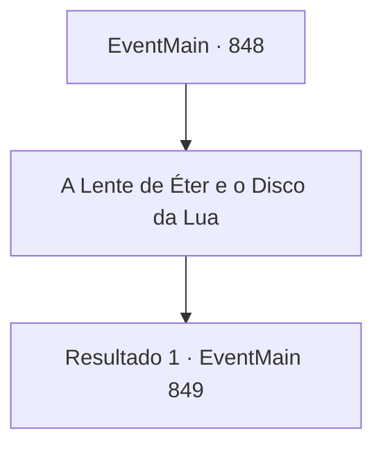

# Eventos principais · 848

[Índice da tabela](index.md) · [Índice geral](../index.md)

ID: `pt:EventMain:848` · Fonte: `EventMain4` · Versão: 1.2.47.

Mapeamento estático dos arquivos; a disponibilidade e a execução dependem do estado da run.

## Texto do evento

*Sem texto no arquivo.*

## Dados de entrada

```json
{
  "id": 848,
  "grade": 1,
  "normalGoal": "",
  "required": ""
}
```

## Mapa das escolhas



## Escolhas e resultados

### Escolha 1

A Lente de Éter e o Disco da Lua

Requisitos e outros campos da escolha:

```json
{
  "required": ""
}
```

#### Resultado 1.1

Você se lembra dos artefatos que Naverr estava procurando. Você fala da Lente de Éter e do Disco da Lua. O grippli mais velho revira os olhos por um momento e continua. 

 "Ah, sim. Eu vejo. O Disco da Lua... Eu ouvi falar disso. A localização desse artefato... é o farol em uma cidade chamada Sinias."

 O mais velho deseja sorte a você e a Rosilpha enquanto os dois saem, presenteando você com uma poção de suas prateleiras. Vocês agradecem ao mais velho e saem da cabana, apenas para se deparar com um grupo de gripplis intimidando vocês. 

 "Vocês têm sido muito intrometidos ultimamente, queridos-Grippli. Quem são vocês para importunar nosso ancião? É porque vocês não têm pais?! Vocês nem são gripplis de verdade!"

 Eles explodem em risadas parecidas com sapos. Os punhos de Rosilpha se endurecem de raiva. Antes que você possa impedi-lo, Rosilpha desfere um soco certeiro na mandíbula de um dos gripplis.

Continuação registrada: [Evento 849](0849.md) na mesma tabela.

```json
{
  "required": "",
  "chance": "1",
  "nextEvent": 849,
  "type": 2,
  "reward": "3_36_1|3_37_1"
}
```

## Referências que chegam a este evento

- [Evento 847 · escolha 1 · resultado 1](0847.md#escolha-1)
