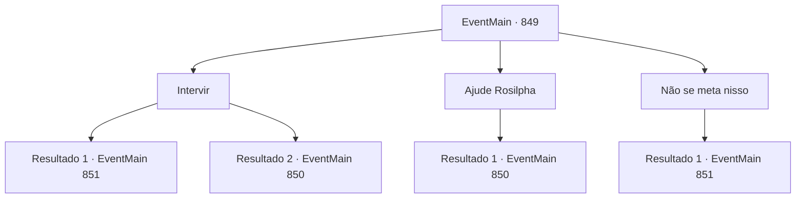

# Eventos principais · 849

[Índice da tabela](index.md) · [Índice geral](../index.md)

ID: `pt:EventMain:849` · Fonte: `EventMain4` · Versão: 1.2.47.

Mapeamento estático dos arquivos; a disponibilidade e a execução dependem do estado da run.

## Texto do evento

*Sem texto no arquivo.*

## Dados de entrada

```json
{
  "id": 849,
  "grade": 1,
  "normalGoal": "",
  "required": ""
}
```

## Mapa das escolhas



## Escolhas e resultados

### Escolha 1

Intervir

Requisitos e outros campos da escolha:

```json
{
  "required": ""
}
```

#### Resultado 1.1

Você para a briga com seu carisma. Ao intervir para impedir que a briga se intensifique, os gripplis decidem se afastar, xingando Rosilpha. Rosilpha finalmente volta a si. 

 "...Desculpe. Você não precisava ver isso. Então... para onde estamos indo?"


Continuação registrada: [Evento 851](0851.md) na mesma tabela.

```json
{
  "required": "",
  "chance": "1|0_12_1",
  "nextEvent": 851,
  "type": 0,
  "reward": ""
}
```

#### Resultado 1.2

Você tenta parar a briga, mas só acaba agravando a tensão. Pegue no fogo cruzado, agora você não tem escolha a não ser revidar.

Continuação registrada: [Evento 850](0850.md) na mesma tabela.

```json
{
  "required": "",
  "chance": "16",
  "nextEvent": 850,
  "type": 1,
  "reward": "6_0_174",
  "place": 1
}
```

### Escolha 2

Ajude Rosilpha

Requisitos e outros campos da escolha:

```json
{
  "required": ""
}
```

#### Resultado 2.1

Você decide se juntar a Rosilpha e dar uma lição a esses anfíbios arrogantes.

Continuação registrada: [Evento 850](0850.md) na mesma tabela.

```json
{
  "required": "",
  "chance": "1",
  "nextEvent": 850,
  "type": 2,
  "reward": "6_0_174",
  "place": 1
}
```

### Escolha 3

Não se meta nisso

Requisitos e outros campos da escolha:

```json
{
  "required": ""
}
```

#### Resultado 3.1

Você fica longe de Rosilpha, observando a luta se desenrolar. Os gripplis são derrotados pelo halfling, e o grupo logo se dispersa, amaldiçoando Rosilpha enquanto fogem. Rosilpha também deve ter sofrido algum dano - ele começa a falar, esfregando os olhos inchados. 

 "Desculpe. Você não precisava ver isso. Então... para onde estamos indo?"


Continuação registrada: [Evento 851](0851.md) na mesma tabela.

```json
{
  "required": "",
  "chance": "1",
  "nextEvent": 851,
  "type": 2,
  "reward": ""
}
```

## Referências que chegam a este evento

- [Evento 848 · escolha 1 · resultado 1](0848.md#escolha-1)
