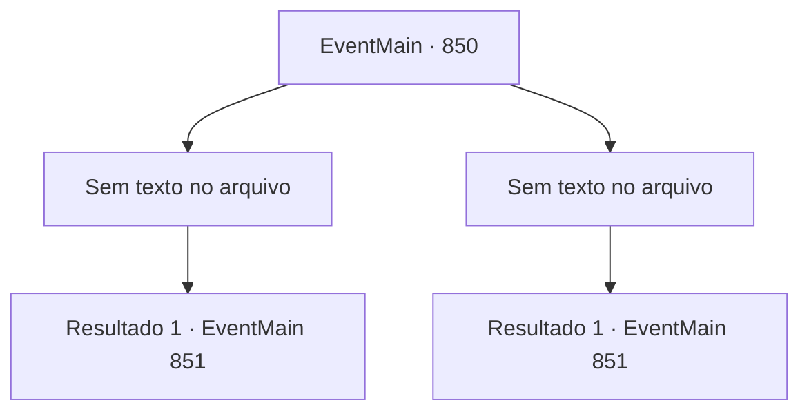

# Eventos principais · 850

[Índice da tabela](index.md) · [Índice geral](../index.md)

ID: `pt:EventMain:850` · Fonte: `EventMain4` · Versão: 1.2.47.

Mapeamento estático dos arquivos; a disponibilidade e a execução dependem do estado da run.

## Texto do evento

*Sem texto no arquivo.*

## Dados de entrada

```json
{
  "id": 850,
  "grade": 1,
  "normalGoal": "",
  "required": ""
}
```

## Mapa das escolhas



## Escolhas e resultados

### Escolha 1

*Sem texto no arquivo; o papel dessa opção depende da interface do jogo.*

Requisitos e outros campos da escolha:

```json
{
  "required": ""
}
```

#### Resultado 1.1

Você e Rosilpha ensinam aos gripplis para não mexerem com vocês dois. Logo eles se dispersam, amaldiçoando você e Rosilpha enquanto fogem. Rosilpha finalmente volta a si. 

 "...Obrigado pela ajuda. Você não precisava ver isso. Então... para onde estamos indo?"


Continuação registrada: [Evento 851](0851.md) na mesma tabela.

```json
{
  "required": "",
  "chance": "1",
  "nextEvent": 851,
  "type": 2,
  "reward": ""
}
```

### Escolha 2

*Sem texto no arquivo; o papel dessa opção depende da interface do jogo.*

Requisitos e outros campos da escolha:

```json
{
  "required": ""
}
```

#### Resultado 2.1

A briga entre você, Rosilpha e os gripplis finalmente chega ao fim quando o grippli mais velho sai de sua cabana para intervir. Os gripplis logo se dispersam, amaldiçoando você e Rosilpha enquanto fogem. O mais velho os repreende, lembrando-os de que brigar no meio da cidade não é um bom comportamento. Rosilpha finalmente volta a si. 

 "Desculpe..."

 O mais velho também repreende Rosilpha severamente. Rosilpha deve ter sofrido algum dano também - ele começa a falar, esfregando os olhos inchados. 

 "...Desculpas. Você não precisava ver isso. Então... para onde estamos indo?"


Continuação registrada: [Evento 851](0851.md) na mesma tabela.

```json
{
  "required": "",
  "chance": "1",
  "nextEvent": 851,
  "type": 2,
  "reward": ""
}
```

## Referências que chegam a este evento

- [Evento 849 · escolha 1 · resultado 2](0849.md#escolha-1)
- [Evento 849 · escolha 2 · resultado 1](0849.md#escolha-2)
