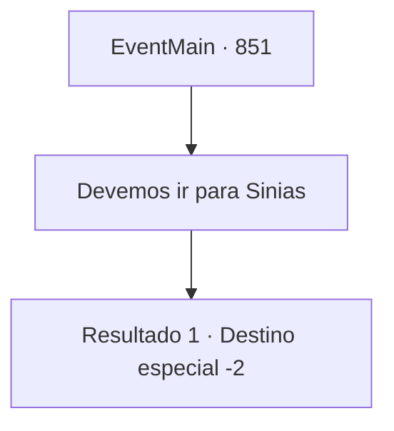

# Eventos principais · 851

[Índice da tabela](index.md) · [Índice geral](../index.md)

ID: `pt:EventMain:851` · Fonte: `EventMain4` · Versão: 1.2.47.

Mapeamento estático dos arquivos; a disponibilidade e a execução dependem do estado da run.

## Texto do evento

*Sem texto no arquivo.*

## Dados de entrada

```json
{
  "id": 851,
  "grade": 1,
  "normalGoal": "",
  "required": ""
}
```

## Mapa das escolhas



## Escolhas e resultados

### Escolha 1

Devemos ir para Sinias

Requisitos e outros campos da escolha:

```json
{
  "required": ""
}
```

#### Resultado 1.1

Você diz que tem que ir para 'Sinias' conforme ouve do ancião. Naverr deve estar em 'Sinias', procurando pelo 'Farol de Sinias'. Após ouvir de você, Rosilpha diz que ele tem preparativos para fazer, e que os dois devem se encontrar lá. Você se despede dele, deixa Floating Duckweed e segue para Sinias.

Continuação registrada: [Destino especial `-2`](../destinos-especiais.md).

```json
{
  "required": "",
  "chance": "1",
  "nextEvent": -2,
  "type": 2,
  "reward": "13_5_2|0_2_1"
}
```

## Referências que chegam a este evento

- [Evento 849 · escolha 1 · resultado 1](0849.md#escolha-1)
- [Evento 849 · escolha 3 · resultado 1](0849.md#escolha-3)
- [Evento 850 · escolha 1 · resultado 1](0850.md#escolha-1)
- [Evento 850 · escolha 2 · resultado 1](0850.md#escolha-2)
