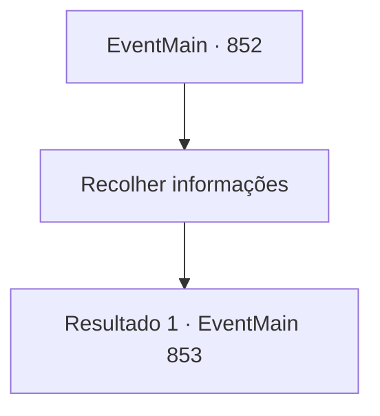

# Eventos principais · 852

[Índice da tabela](index.md) · [Índice geral](../index.md)

ID: `pt:EventMain:852` · Fonte: `EventMain4` · Versão: 1.2.47.

Mapeamento estático dos arquivos; a disponibilidade e a execução dependem do estado da run.

## Texto do evento

|drawing_sinias|  Você chega a 'Sinias'.  'Sinias' é uma cidade em um penhasco costeiro, onde as pessoas são divididas em uma classe baixa de pescadores e comerciantes,  e uma classe alta de administradores, guardas e outros que mantêm a cidade.  Mas não importa para onde você olhe, não há um farol.

## Dados de entrada

```json
{
  "id": 852,
  "grade": 1,
  "normalGoal": "",
  "required": "13_5_2|1_2_50"
}
```

## Mapa das escolhas



## Escolhas e resultados

### Escolha 1

Recolher informações

Requisitos e outros campos da escolha:

```json
{
  "required": ""
}
```

#### Resultado 1.1

Você vagando por Sinias, pergunta às pessoas se conhecem o Farol de Sinias, mas as únicas respostas que você recebe são ignorância ou 'Não'. Nesse momento, Rosilpha se aproxima de você. 

 "Oh, finalmente. Bom te ver de novo."

 Você o cumprimenta e compartilha as informações que ele tem. Ele diz que um anão ferreiro na cidade saberia sobre o farol. 

 "Ouvi dizer que ele mora aqui há mais de um século. Então ele saberia melhor sobre os velhos tempos."

 Você e Rosilpha seguem direto para a forja na área do mercado. Assim como o anão ferreiro idoso, equipamentos antigos e enferrujados enchem a forja, mas ainda é possível ouvir o som do metal  batendo e sentir o calor. 

 O anão, martelando o aço aquecido, enxuga o suor com suas luvas sujas de fuligem e te cumprimenta. 

 "Então, o que te traz aqui?"


Continuação registrada: [Evento 853](0853.md) na mesma tabela.

```json
{
  "required": "",
  "chance": "1",
  "nextEvent": 853,
  "type": 2,
  "reward": ""
}
```

## Referências que chegam a este evento

Nenhum `nextEvent` positivo da mesma tabela aponta para este nó. Isso não prova que seja inacessível: sorteio e estado de história podem selecioná-lo.

