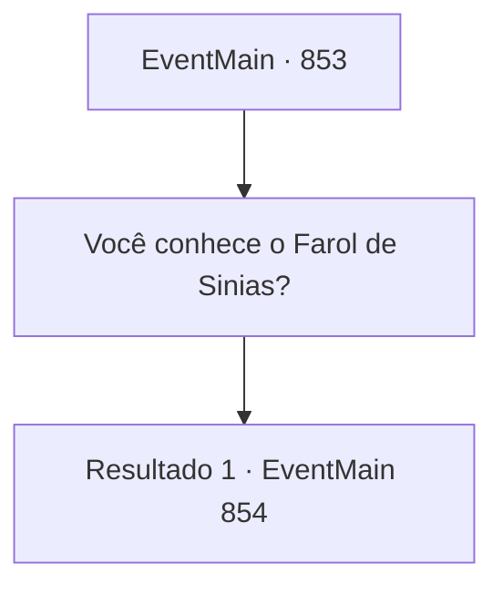

# Eventos principais · 853

[Índice da tabela](index.md) · [Índice geral](../index.md)

ID: `pt:EventMain:853` · Fonte: `EventMain4` · Versão: 1.2.47.

Mapeamento estático dos arquivos; a disponibilidade e a execução dependem do estado da run.

## Texto do evento

*Sem texto no arquivo.*

## Dados de entrada

```json
{
  "id": 853,
  "grade": 1,
  "normalGoal": "",
  "required": ""
}
```

## Mapa das escolhas



## Escolhas e resultados

### Escolha 1

Você conhece o Farol de Sinias?

Requisitos e outros campos da escolha:

```json
{
  "required": ""
}
```

#### Resultado 1.1

Ele para o que está fazendo e caminha até um mapa na parede. Com uma expressão de preocupação, ele o observa por um momento. 

 "Bem, hmm... Acho que era aqui..."

 Ele aponta para um ponto no mapa e continua. 

 "Você mal consegue ver isso por fora, mas verá quando mergulhar."

 Então ele mostra o equipamento de mergulho que ele fez. É uma peça única, feita de bronze, composta por um capacete redondo e um objeto cilíndrico acoplado a ele. 

 "Apenas eu posso fazer algo assim. Vou cobrar 200 ouro por dois pares."


Continuação registrada: [Evento 854](0854.md) na mesma tabela.

```json
{
  "required": "",
  "chance": "1",
  "nextEvent": 854,
  "type": 2,
  "reward": ""
}
```

## Referências que chegam a este evento

- [Evento 852 · escolha 1 · resultado 1](0852.md#escolha-1)
