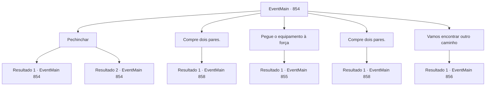

# Eventos principais · 854

[Índice da tabela](index.md) · [Índice geral](../index.md)

ID: `pt:EventMain:854` · Fonte: `EventMain4` · Versão: 1.2.47.

Mapeamento estático dos arquivos; a disponibilidade e a execução dependem do estado da run.

## Texto do evento

*Sem texto no arquivo.*

## Dados de entrada

```json
{
  "id": 854,
  "grade": 1,
  "normalGoal": "",
  "required": ""
}
```

## Mapa das escolhas



## Escolhas e resultados

### Escolha 1

Pechinchar

Requisitos e outros campos da escolha:

```json
{
  "required": "5_653_0"
}
```

#### Resultado 1.1

Você pede a ele um desconto. O anão sacode a fuligem de sua barba e pede que você o ajude em seu trabalho em troca de um desconto. Você concorda em fazer trabalhos diversos, como carregar aço aquecido e transportar carvão para o fogo. Então ele concorda em baixar o preço para 150.

Continuação registrada: [Evento 854](0854.md) na mesma tabela.

```json
{
  "required": "",
  "chance": "1|0_12_1",
  "nextEvent": 854,
  "type": 0,
  "reward": "5_653_1"
}
```

#### Resultado 1.2

Você pede a ele um desconto. Ele te examina de cima a baixo, acariciando a barba, e então recusa.

Continuação registrada: [Evento 854](0854.md) na mesma tabela.

```json
{
  "required": "",
  "chance": "16",
  "nextEvent": 854,
  "type": 1,
  "reward": "5_653_2"
}
```

### Escolha 2

Compre dois pares.

Requisitos e outros campos da escolha:

```json
{
  "required": "1_4_200|18_653_1"
}
```

#### Resultado 2.1

Você compra dois pares do equipamento. Um para você, e um para Rosilpha. Você entrega o equipamento para ele. Rosilpha alega que, sendo um grippli, ele não precisa do equipamento de mergulho, mas mesmo assim o leva. 

 "Um... Sabe, só por precaução, posso perder o foco... Além disso, não seria melhor pegar um barco em vez de nadar até aquele ponto?"


Continuação registrada: [Evento 858](0858.md) na mesma tabela.

```json
{
  "required": "",
  "chance": "1",
  "nextEvent": 858,
  "type": 2,
  "reward": "0_4_-200|3_311_1"
}
```

### Escolha 3

Pegue o equipamento à força

Requisitos e outros campos da escolha:

```json
{
  "required": "2_3_25"
}
```

#### Resultado 3.1

Você decide pegar o equipamento à força. O ferreiro, relutante em ceder facilmente, empunha um martelo e te enfrenta.

Continuação registrada: [Evento 855](0855.md) na mesma tabela.

```json
{
  "required": "",
  "chance": "1",
  "nextEvent": 855,
  "type": 2,
  "reward": "6_0_87",
  "place": 4
}
```

### Escolha 4

Compre dois pares.

Requisitos e outros campos da escolha:

```json
{
  "required": "1_4_150|5_653_1"
}
```

#### Resultado 4.1

Você compra dois pares do equipamento. Um para você, e um para Rosilpha. Você entrega o equipamento para ele. Rosilpha alega que, sendo um grippli, ele não precisa do equipamento de mergulho, mas mesmo assim o leva. 

 "Um... Sabe, só por precaução, caso eu perca o foco... Além disso, não seria melhor pegar um barco em vez de nadar até aquele ponto?"


Continuação registrada: [Evento 858](0858.md) na mesma tabela.

```json
{
  "required": "",
  "chance": "1",
  "nextEvent": 858,
  "type": 2,
  "reward": "0_4_-150|3_311_1"
}
```

### Escolha 5

Vamos encontrar outro caminho

Requisitos e outros campos da escolha:

```json
{
  "required": ""
}
```

#### Resultado 5.1

Você abandona a ideia de comprar o equipamento e sai da forja. Rosilpha fala após um momento de contemplação. 

 "Espere aqui por um momento. Vou tentar encontrar uma solução."

 Quando ele retorna um pouco mais tarde, há um frasco em sua mão contendo um líquido azul escuro.

Continuação registrada: [Evento 856](0856.md) na mesma tabela.

```json
{
  "required": "",
  "chance": "1",
  "nextEvent": 856,
  "type": 2,
  "reward": ""
}
```

## Referências que chegam a este evento

- [Evento 853 · escolha 1 · resultado 1](0853.md#escolha-1)
- [Evento 854 · escolha 1 · resultado 1](0854.md#escolha-1)
- [Evento 854 · escolha 1 · resultado 2](0854.md#escolha-1)
