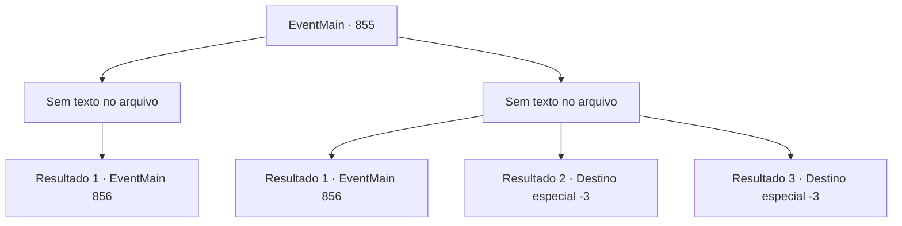

# Eventos principais · 855

[Índice da tabela](index.md) · [Índice geral](../index.md)

ID: `pt:EventMain:855` · Fonte: `EventMain4` · Versão: 1.2.47.

Mapeamento estático dos arquivos; a disponibilidade e a execução dependem do estado da run.

## Texto do evento

*Sem texto no arquivo.*

## Dados de entrada

```json
{
  "id": 855,
  "grade": 1,
  "normalGoal": "",
  "required": ""
}
```

## Mapa das escolhas



## Escolhas e resultados

### Escolha 1

*Sem texto no arquivo; o papel dessa opção depende da interface do jogo.*

Requisitos e outros campos da escolha:

```json
{
  "required": ""
}
```

#### Resultado 1.1

Enquanto você está batendo ferozmente no ferreiro, Rosilpha te impede. 

 "Espera, ESPERA! Não faça isso."

 Ele ajuda o ferreiro caído e pede desculpas em seu nome. Então ele te leva para fora da forja. 

 "Não vamos causar problemas desnecessários. Eu tenho outro jeito. Aqui... Beba isso."

 Ele tem um frasco em sua mão contendo um líquido azul escuro.

Continuação registrada: [Evento 856](0856.md) na mesma tabela.

```json
{
  "required": "",
  "chance": "1",
  "nextEvent": 856,
  "type": 2,
  "reward": "0_3_-2"
}
```

### Escolha 2

*Sem texto no arquivo; o papel dessa opção depende da interface do jogo.*

Requisitos e outros campos da escolha:

```json
{
  "required": ""
}
```

#### Resultado 2.1

Você foge do martelo do ferreiro e corre para fora da forja. Ele grita veementemente para nunca mais mostrar seu rosto, e Rosilpha se desculpa em seu nome. Então ele tira algo do seu bolso interno. 

 "Aqui... Beba isso."

 Há um frasco em sua mão contendo um líquido azul escuro.

Continuação registrada: [Evento 856](0856.md) na mesma tabela.

```json
{
  "required": "1_0_2|1_1_2",
  "chance": "1",
  "nextEvent": 856,
  "type": 2,
  "reward": "0_0_-1|0_1_-1"
}
```

#### Resultado 2.2

O martelo do ferreiro atinge sua cabeça e, com um choque cegante, você perde a consciência.

Continuação registrada: [Destino especial `-3`](../destinos-especiais.md).

```json
{
  "required": "2_0_2",
  "chance": "1",
  "nextEvent": -3,
  "type": 2,
  "reward": "0_0_-1|0_1_-1"
}
```

#### Resultado 2.3

O martelo do ferreiro atinge sua cabeça e, com um choque cegante, você perde a consciência.

Continuação registrada: [Destino especial `-3`](../destinos-especiais.md).

```json
{
  "required": "2_1_2",
  "chance": "1",
  "nextEvent": -3,
  "type": 2,
  "reward": "0_0_-1|0_1_-1"
}
```

## Referências que chegam a este evento

- [Evento 854 · escolha 3 · resultado 1](0854.md#escolha-3)
