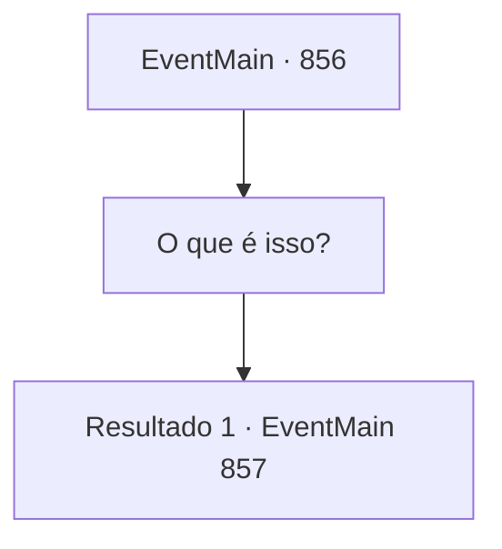

# Eventos principais · 856

[Índice da tabela](index.md) · [Índice geral](../index.md)

ID: `pt:EventMain:856` · Fonte: `EventMain4` · Versão: 1.2.47.

Mapeamento estático dos arquivos; a disponibilidade e a execução dependem do estado da run.

## Texto do evento

*Sem texto no arquivo.*

## Dados de entrada

```json
{
  "id": 856,
  "grade": 1,
  "normalGoal": "",
  "required": ""
}
```

## Mapa das escolhas



## Escolhas e resultados

### Escolha 1

O que é isso?

Requisitos e outros campos da escolha:

```json
{
  "required": ""
}
```

#### Resultado 1.1

Rosilpha coça a bochecha de forma desajeitada enquanto responde à sua pergunta. 

 "...Este é um frasco de respiração subaquática. Os Gripplis são supostos a respirar debaixo d'água... Então eu sempre carrego comigo."


Continuação registrada: [Evento 857](0857.md) na mesma tabela.

```json
{
  "required": "",
  "chance": "1",
  "nextEvent": 857,
  "type": 2,
  "reward": ""
}
```

## Referências que chegam a este evento

- [Evento 854 · escolha 5 · resultado 1](0854.md#escolha-5)
- [Evento 855 · escolha 1 · resultado 1](0855.md#escolha-1)
- [Evento 855 · escolha 2 · resultado 1](0855.md#escolha-2)
