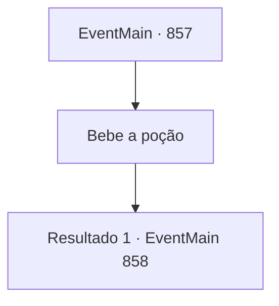

# Eventos principais · 857

[Índice da tabela](index.md) · [Índice geral](../index.md)

ID: `pt:EventMain:857` · Fonte: `EventMain4` · Versão: 1.2.47.

Mapeamento estático dos arquivos; a disponibilidade e a execução dependem do estado da run.

## Texto do evento

*Sem texto no arquivo.*

## Dados de entrada

```json
{
  "id": 857,
  "grade": 1,
  "normalGoal": "",
  "required": ""
}
```

## Mapa das escolhas



## Escolhas e resultados

### Escolha 1

Bebe a poção

Requisitos e outros campos da escolha:

```json
{
  "required": ""
}
```

#### Resultado 1.1

Você engole a poção. Ela tem um cheiro semelhante ao mar. Logo em seguida, brânquias semelhantes às de tubarão aparecem em seu pescoço. Assim como o seu, o pescoço de Rosilpha passa pela mesma mudança. 

 "Deixando isso de lado, não seria melhor pegar um barco em vez de nadar até aquele ponto?"


Continuação registrada: [Evento 858](0858.md) na mesma tabela.

```json
{
  "required": "",
  "chance": "1",
  "nextEvent": 858,
  "type": 2,
  "reward": ""
}
```

## Referências que chegam a este evento

- [Evento 856 · escolha 1 · resultado 1](0856.md#escolha-1)
