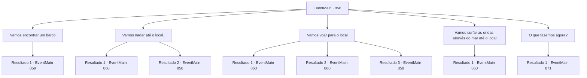

# Eventos principais · 858

[Índice da tabela](index.md) · [Índice geral](../index.md)

ID: `pt:EventMain:858` · Fonte: `EventMain4` · Versão: 1.2.47.

Mapeamento estático dos arquivos; a disponibilidade e a execução dependem do estado da run.

## Texto do evento

*Sem texto no arquivo.*

## Dados de entrada

```json
{
  "id": 858,
  "grade": 1,
  "normalGoal": "",
  "required": ""
}
```

## Mapa das escolhas



## Escolhas e resultados

### Escolha 1

Vamos encontrar um barco

Requisitos e outros campos da escolha:

```json
{
  "required": "5_655_0"
}
```

#### Resultado 1.1

Você e Rosilpha seguem juntos em direção ao cais. Pequenos barcos de pesca balançam suavemente nas ondas calmas, enquanto pescadores se movimentam, descarregando peixes ou consertando redes. Rosilpha se aproxima de um deles, o cumprimenta e pede emprestado seu barco por um tempo. Um pescador de meia-idade olha para você e Rosilpha e estende sua mão grossa. 

 "Maldição, estou de folga... Apenas dê 50 ouros."


Continuação registrada: [Evento 859](0859.md) na mesma tabela.

```json
{
  "required": "",
  "chance": "1",
  "nextEvent": 859,
  "type": 2,
  "reward": "5_655_1"
}
```

### Escolha 2

Vamos nadar até o local.

Requisitos e outros campos da escolha:

```json
{
  "required": "5_656_0"
}
```

#### Resultado 2.1

Você sugere nadar para longe. Então Rosilpha responde com entusiasmo. 

 "Muito bem! Vou te mostrar a habilidade de natação de um grippli."

 Você e Rosilpha pulam direto para o mar e nadam até o local mencionado pelo ferreiro. Olhando para baixo no oceano azul profundo, como o ferreiro disse, o farol revela suas silhuetas afundadas na água. 

 "Olhe. Ali."

 Rosilpha avista o farol e grita. |drawing_seaRemains| Sob a calma do mar, uma cidade antiga está adormecida. O que um dia deve ter sido movimentado por pessoas agora é lar de corais e peixes. O Farol de Sinias é de uma arquitetura tão colossal que comanda reconhecimento com apenas um olhar.

Continuação registrada: [Evento 860](0860.md) na mesma tabela.

```json
{
  "required": "",
  "chance": "1|0_13_1|0_5_1",
  "nextEvent": 860,
  "type": 0,
  "reward": "5_656_1"
}
```

#### Resultado 2.2

Você sugere nadar para longe. Então Rosilpha responde com entusiasmo. 

 "Muito bem! Vou te mostrar a habilidade de natação de um grippli."

 Você e Rosilpha pulam direto para o mar e nadam até o local mencionado pelo ferreiro. Mas sua habilidade de natação não é suficiente para mantê-lo indo. Devido a uma cãibra muscular repentina, você não consegue mais nadar. Você engole a água salgada e peixosa e Rosilpha te arrasta para a costa. Ele te dá tapinhas nas costas enquanto você cospe a água. 

 "Vamos encontrar outro caminho."


Continuação registrada: [Evento 858](0858.md) na mesma tabela.

```json
{
  "required": "",
  "chance": "30",
  "nextEvent": 858,
  "type": 1,
  "reward": "5_656_1"
}
```

### Escolha 3

Vamos voar para o local

Requisitos e outros campos da escolha:

```json
{
  "required": "5_657_0"
}
```

#### Resultado 3.1

Você sobe com Rosilpha. E voam para o local mencionado pelo ferreiro. Olhando para baixo para o oceano azul profundo, você não consegue ver nada. 

 "Precisamos mergulhar para descobrir."

 Você e Rosilpha pulam direto para o mar. Depois de nadar por um tempo, as silhuetas de ruínas afundadas no leito do mar se tornam visíveis. |drawing_seaRemains| A cidade que um dia estava cheia de pessoas agora é lar de corais e peixes. O Farol de Sinias é de uma arquitetura tão colossal que comanda reconhecimento com apenas um olhar.

Continuação registrada: [Evento 860](0860.md) na mesma tabela.

```json
{
  "required": "20_10_1",
  "chance": "1",
  "nextEvent": 860,
  "type": 2,
  "reward": "5_657_1"
}
```

#### Resultado 3.2

Você sobe com Rosilpha. E voam para o local mencionado pelo ferreiro. Olhando para baixo no oceano azul profundo, você não consegue ver nada. 

 "Precisamos mergulhar para descobrir."

 Você e Rosilpha pulam direto para o mar. Depois de nadar por um tempo, as silhuetas de ruínas afundadas no leito do mar se tornam visíveis. |drawing_seaRemains| A cidade que um dia estava cheia de pessoas agora é lar de corais e peixes. O Farol de Sinias é de uma arquitetura tão colossal que comanda reconhecimento com apenas um olhar.

Continuação registrada: [Evento 860](0860.md) na mesma tabela.

```json
{
  "required": "20_0_4",
  "chance": "1",
  "nextEvent": 860,
  "type": 2,
  "reward": "5_657_1"
}
```

#### Resultado 3.3

Você quer voar até o local, mas não há como fazer isso. Tudo o que você pode fazer é chutar a pedra aos seus pés, e decide pensar em outra maneira.

Continuação registrada: [Evento 858](0858.md) na mesma tabela.

```json
{
  "required": "21_10_1|21_0_4",
  "chance": "1",
  "nextEvent": 858,
  "type": 2,
  "reward": "5_657_1"
}
```

### Escolha 4

Vamos surfar as ondas através do mar até o local

Requisitos e outros campos da escolha:

```json
{
  "required": "8_95_1|5_657_0"
}
```

#### Resultado 4.1

Você pega Rosilpha e galopa sobre o mar, indo em direção ao local mencionado pelo ferreiro. Olhando para baixo no oceano azul profundo, você não consegue ver nada. 

 "Precisamos mergulhar para descobrir."

 Você e Rosilpha pulam direto no mar. Depois de nadar por um tempo, as silhuetas de ruínas afundadas no leito marinho se tornam visíveis. |drawing_seaRemains| A cidade que um dia estava cheia de pessoas agora é lar de corais e peixes. O Farol de Sinias é de uma arquitetura tão colossal que comanda reconhecimento com apenas um olhar.

Continuação registrada: [Evento 860](0860.md) na mesma tabela.

```json
{
  "required": "",
  "chance": "1",
  "nextEvent": 860,
  "type": 2,
  "reward": "5_657_1"
}
```

### Escolha 5

O que fazemos agora?

Requisitos e outros campos da escolha:

```json
{
  "required": "5_655_1|5_656_1|5_657_1"
}
```

#### Resultado 5.1

Você pergunta a Rosilpha o que fazer. Mas ele não consegue pensar em outra maneira. Enquanto isso, uma mulher que parece uma aventureira se aproxima e fala com você. 

 "Você é {1}. Rian Naverrovna me pediu para lhe entregar isso."

 Ela lhe entrega uma carta e sai. É uma carta escrita por Rian, filha de Naverr.
 'Contratei aventureiros para encontrar meu pai. Acho que eles poderiam usar sua ajuda. Não seria melhor para você também do que procurar sozinho?'
 A carta sugere que você coopere com os aventureiros e indica um ponto de encontro.

Continuação registrada: [Evento 871](0871.md) na mesma tabela.

```json
{
  "required": "",
  "chance": "1",
  "nextEvent": 871,
  "type": 2,
  "reward": ""
}
```

## Referências que chegam a este evento

- [Evento 854 · escolha 2 · resultado 1](0854.md#escolha-2)
- [Evento 854 · escolha 4 · resultado 1](0854.md#escolha-4)
- [Evento 857 · escolha 1 · resultado 1](0857.md#escolha-1)
- [Evento 858 · escolha 2 · resultado 2](0858.md#escolha-2)
- [Evento 858 · escolha 3 · resultado 3](0858.md#escolha-3)
- [Evento 859 · escolha 4 · resultado 2](0859.md#escolha-4)
