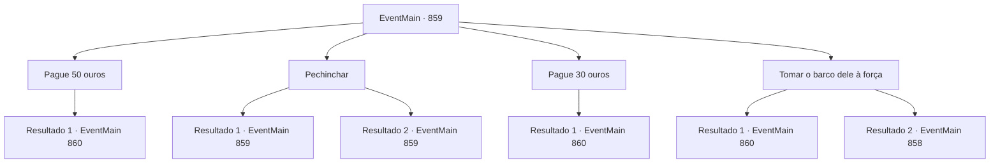

# Eventos principais · 859

[Índice da tabela](index.md) · [Índice geral](../index.md)

ID: `pt:EventMain:859` · Fonte: `EventMain4` · Versão: 1.2.47.

Mapeamento estático dos arquivos; a disponibilidade e a execução dependem do estado da run.

## Texto do evento

*Sem texto no arquivo.*

## Dados de entrada

```json
{
  "id": 859,
  "grade": 1,
  "normalGoal": "",
  "required": ""
}
```

## Mapa das escolhas



## Escolhas e resultados

### Escolha 1

Pague 50 ouros

Requisitos e outros campos da escolha:

```json
{
  "required": "1_4_50|18_658_1"
}
```

#### Resultado 1.1

Você paga ouro pelo barco do pescador. Ele habilmente conduz o barco e leva você e Rosilpha até o farol. Olhando para baixo no oceano azul profundo, você não consegue ver nada. 

 "Precisamos mergulhar para descobrir."

 Você e Rosilpha pulam direto no mar. Depois de nadar por um tempo, as silhuetas de ruínas submersas no leito do mar se tornam visíveis. |drawing_seaRemains| A cidade que um dia foi movimentada por pessoas agora é lar de corais e peixes. O Farol de Sinias é de uma arquitetura tão colossal que chama atenção à primeira vista.

Continuação registrada: [Evento 860](0860.md) na mesma tabela.

```json
{
  "required": "",
  "chance": "1",
  "nextEvent": 860,
  "type": 2,
  "reward": "0_4_-50"
}
```

### Escolha 2

Pechinchar

Requisitos e outros campos da escolha:

```json
{
  "required": "5_658_0"
}
```

#### Resultado 2.1

Você tenta negociar com o pescador. O pescador coça a cabeça e eventualmente concorda. 

 "Tudo bem... Apenas me dê 30 ouros."


Continuação registrada: [Evento 859](0859.md) na mesma tabela.

```json
{
  "required": "",
  "chance": "1|0_12_1",
  "nextEvent": 859,
  "type": 0,
  "reward": "5_658_1"
}
```

#### Resultado 2.2

Você tenta negociar com o pescador, mas ele balança a cabeça. 

 "Não vai acontecer, eu acho."


Continuação registrada: [Evento 859](0859.md) na mesma tabela.

```json
{
  "required": "",
  "chance": "12",
  "nextEvent": 859,
  "type": 1,
  "reward": "5_658_2"
}
```

### Escolha 3

Pague 30 ouros

Requisitos e outros campos da escolha:

```json
{
  "required": "1_4_30|5_658_1"
}
```

#### Resultado 3.1

Você paga ouro pelo barco do pescador. Ele habilmente conduz o barco e leva você e Rosilpha até o farol. Olhando para baixo no oceano azul profundo, você não consegue ver nada. 

 "Precisamos mergulhar para descobrir."

 Você e Rosilpha pulam direto no mar. Depois de nadar por um tempo, as silhuetas de ruínas submersas no leito do mar se tornam visíveis. |drawing_seaRemains| A cidade que um dia foi movimentada por pessoas agora é lar de corais e peixes. O Farol de Sinias é de uma arquitetura tão colossal que chama atenção à primeira vista.

Continuação registrada: [Evento 860](0860.md) na mesma tabela.

```json
{
  "required": "",
  "chance": "1",
  "nextEvent": 860,
  "type": 2,
  "reward": "0_4_-30"
}
```

### Escolha 4

Tomar o barco dele à força

Requisitos e outros campos da escolha:

```json
{
  "required": ""
}
```

#### Resultado 4.1

Você decide pegar o barco à força. Mas, Rosilpha se coloca em seu caminho. 

 "Espera, espera... acalme-se. Eu vou resolver isso."

 Depois de conversar com o pescador por um tempo, ele conseguiu convencê-lo com sucesso. O pescador dá uma olhada rápida em você e depois pula no barco. Ele habilmente conduz o barco e leva você e Rosilpha até o farol. Olhando para o oceano azul profundo, você não consegue ver nada. 

 "Precisamos mergulhar para descobrir."

 Você e Rosilpha pulam direto no mar. Depois de nadar por um tempo, as silhuetas de ruínas afundadas no leito do mar se tornam visíveis. |drawing_seaRemains| A cidade que um dia estava cheia de pessoas agora é lar de corais e peixes. O Farol de Sinias é de uma arquitetura tão colossal que comanda reconhecimento à primeira vista.

Continuação registrada: [Evento 860](0860.md) na mesma tabela.

```json
{
  "required": "",
  "chance": "1",
  "nextEvent": 860,
  "type": 2,
  "reward": "0_3_-1"
}
```

#### Resultado 4.2

Você decide apreender o barco com seu punho. Mas, Rosilpha entra em seu caminho. 

 "Espera, espera... acalme-se. Eu vou resolver isso."

 Depois de conversar com o pescador por um tempo, parece que ele não consegue convencer o pescador. 

 "Bem... Você não deveria atacar estranhos assim, não importa o que. Vamos encontrar outro caminho."


Continuação registrada: [Evento 858](0858.md) na mesma tabela.

```json
{
  "required": "",
  "chance": "1",
  "nextEvent": 858,
  "type": 2,
  "reward": "5_655_1"
}
```

## Referências que chegam a este evento

- [Evento 858 · escolha 1 · resultado 1](0858.md#escolha-1)
- [Evento 859 · escolha 2 · resultado 1](0859.md#escolha-2)
- [Evento 859 · escolha 2 · resultado 2](0859.md#escolha-2)
