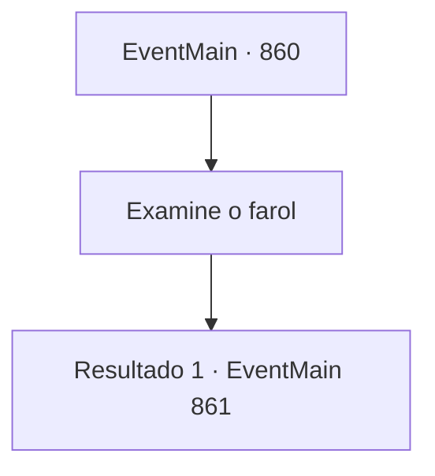

# Eventos principais · 860

[Índice da tabela](index.md) · [Índice geral](../index.md)

ID: `pt:EventMain:860` · Fonte: `EventMain4` · Versão: 1.2.47.

Mapeamento estático dos arquivos; a disponibilidade e a execução dependem do estado da run.

## Texto do evento

*Sem texto no arquivo.*

## Dados de entrada

```json
{
  "id": 860,
  "grade": 1,
  "normalGoal": "",
  "required": ""
}
```

## Mapa das escolhas



## Escolhas e resultados

### Escolha 1

Examine o farol

Requisitos e outros campos da escolha:

```json
{
  "required": ""
}
```

#### Resultado 1.1

O topo colapsado do farol está deitado no fundo, com peixes correndo ao redor dele. O farol parece uma pirâmide, com um cristal no topo e uma pequena janela na parte inferior que poderia ser usada como entrada. Ao entrar pela janela, a escuridão artificial te envolve e Rosilpha. 

 "Está muito escuro para ver... Acho que deve haver uma fonte dessa escuridão."


Continuação registrada: [Evento 861](0861.md) na mesma tabela.

```json
{
  "required": "",
  "chance": "1",
  "nextEvent": 861,
  "type": 2,
  "reward": ""
}
```

## Referências que chegam a este evento

- [Evento 858 · escolha 2 · resultado 1](0858.md#escolha-2)
- [Evento 858 · escolha 3 · resultado 1](0858.md#escolha-3)
- [Evento 858 · escolha 3 · resultado 2](0858.md#escolha-3)
- [Evento 858 · escolha 4 · resultado 1](0858.md#escolha-4)
- [Evento 859 · escolha 1 · resultado 1](0859.md#escolha-1)
- [Evento 859 · escolha 3 · resultado 1](0859.md#escolha-3)
- [Evento 859 · escolha 4 · resultado 1](0859.md#escolha-4)
