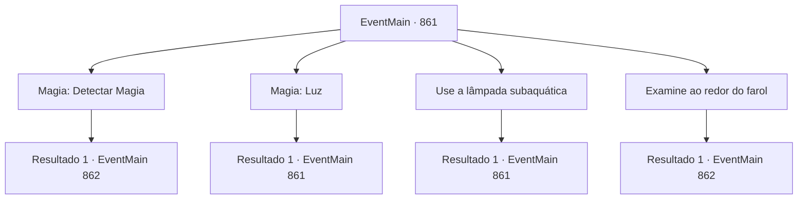

# Eventos principais · 861

[Índice da tabela](index.md) · [Índice geral](../index.md)

ID: `pt:EventMain:861` · Fonte: `EventMain4` · Versão: 1.2.47.

Mapeamento estático dos arquivos; a disponibilidade e a execução dependem do estado da run.

## Texto do evento

*Sem texto no arquivo.*

## Dados de entrada

```json
{
  "id": 861,
  "grade": 1,
  "normalGoal": "",
  "required": ""
}
```

## Mapa das escolhas



## Escolhas e resultados

### Escolha 1

Magia: Detectar Magia

Requisitos e outros campos da escolha:

```json
{
  "required": "20_0_1"
}
```

#### Resultado 1.1

Você detecta a magia fluindo por todo o farol. Está se reunindo em direção à base do farol. Ao chegar ao local onde o fluxo de magia converge, você encontra um monólito maciço inscrito com runas antigas.

Continuação registrada: [Evento 862](0862.md) na mesma tabela.

```json
{
  "required": "",
  "chance": "1",
  "nextEvent": 862,
  "type": 2,
  "reward": ""
}
```

### Escolha 2

Magia: Luz

Requisitos e outros campos da escolha:

```json
{
  "required": "20_0_1|5_659_0"
}
```

#### Resultado 2.1

Você cria uma luz com magia. Mas a luz que você fez é imediatamente consumida pela escuridão do farol. Vendo isso, Rosilpha sugere que devemos tentar uma abordagem diferente.

Continuação registrada: [Evento 861](0861.md) na mesma tabela.

```json
{
  "required": "",
  "chance": "1",
  "nextEvent": 861,
  "type": 2,
  "reward": "5_659_1"
}
```

### Escolha 3

Use a lâmpada subaquática

Requisitos e outros campos da escolha:

```json
{
  "required": "8_210_1|5_659_0"
}
```

#### Resultado 3.1

Você acende a lâmpada subaquática. Mas a luz que você fez foi imediatamente consumida pela escuridão do farol. Vendo isso, Rosilpha sugere que devemos tentar uma abordagem diferente.

Continuação registrada: [Evento 861](0861.md) na mesma tabela.

```json
{
  "required": "",
  "chance": "1",
  "nextEvent": 861,
  "type": 2,
  "reward": "5_659_1"
}
```

### Escolha 4

Examine ao redor do farol

Requisitos e outros campos da escolha:

```json
{
  "required": ""
}
```

#### Resultado 4.1

Você e Rosilpha procuram ao redor do farol. Então, Rosilpha aponta para algum lugar. Ao chegar ao local, você encontra um monólito maciço inscrito com runas antigas.

Continuação registrada: [Evento 862](0862.md) na mesma tabela.

```json
{
  "required": "",
  "chance": "1",
  "nextEvent": 862,
  "type": 2,
  "reward": ""
}
```

## Referências que chegam a este evento

- [Evento 860 · escolha 1 · resultado 1](0860.md#escolha-1)
- [Evento 861 · escolha 2 · resultado 1](0861.md#escolha-2)
- [Evento 861 · escolha 3 · resultado 1](0861.md#escolha-3)
