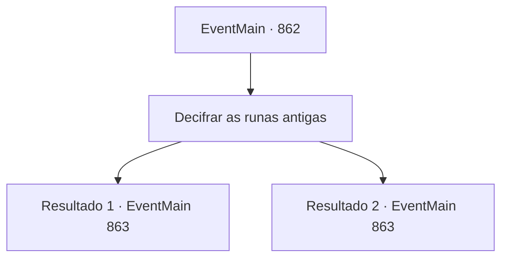

# Eventos principais · 862

[Índice da tabela](index.md) · [Índice geral](../index.md)

ID: `pt:EventMain:862` · Fonte: `EventMain4` · Versão: 1.2.47.

Mapeamento estático dos arquivos; a disponibilidade e a execução dependem do estado da run.

## Texto do evento

*Sem texto no arquivo.*

## Dados de entrada

```json
{
  "id": 862,
  "grade": 1,
  "normalGoal": "",
  "required": ""
}
```

## Mapa das escolhas



## Escolhas e resultados

### Escolha 1

Decifrar as runas antigas

Requisitos e outros campos da escolha:

```json
{
  "required": ""
}
```

#### Resultado 1.1

Você se lembra do que aprendeu com Naverr antes. E reconhece que a inscrição no monólito são as runas faladas na área em tempos antigos. 

 'Quando o sol ascender ao topo da montanha, a escuridão fugirá.' 

 Ao traduzir a frase, Rosilpha acena com a cabeça e fala. 

 "Oh... Então parece que os objetos ao redor estão de alguma forma conectados."

 Ao olhar para onde Rosilpha apontou, você vê uma esfera coberta de musgo, uma pirâmide e um cubo.

Continuação registrada: [Evento 863](0863.md) na mesma tabela.

```json
{
  "required": "",
  "chance": "1|0_7_1",
  "nextEvent": 863,
  "type": 0,
  "reward": ""
}
```

#### Resultado 1.2

Você investiga as runas no monólito. Parece ser o que você aprendeu antes, mas você não consegue traduzir a frase. Então, Rosilpha encontra algo. 

 "Ah... Então parece que os objetos ao redor estão conectados de alguma forma."

 Ao olhar para onde Rosilpha apontou, você vê uma esfera coberta de musgo, uma pirâmide e um cubo.

Continuação registrada: [Evento 863](0863.md) na mesma tabela.

```json
{
  "required": "",
  "chance": "5",
  "nextEvent": 863,
  "type": 1,
  "reward": ""
}
```

## Referências que chegam a este evento

- [Evento 861 · escolha 1 · resultado 1](0861.md#escolha-1)
- [Evento 861 · escolha 4 · resultado 1](0861.md#escolha-4)
