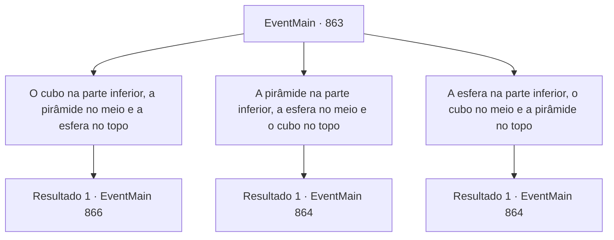

# Eventos principais · 863

[Índice da tabela](index.md) · [Índice geral](../index.md)

ID: `pt:EventMain:863` · Fonte: `EventMain4` · Versão: 1.2.47.

Mapeamento estático dos arquivos; a disponibilidade e a execução dependem do estado da run.

## Texto do evento

*Sem texto no arquivo.*

## Dados de entrada

```json
{
  "id": 863,
  "grade": 1,
  "normalGoal": "",
  "required": ""
}
```

## Mapa das escolhas



## Escolhas e resultados

### Escolha 1

O cubo na parte inferior, a pirâmide no meio e a esfera no topo

Requisitos e outros campos da escolha:

```json
{
  "required": ""
}
```

#### Resultado 1.1

Você coloca o cubo na parte inferior e empilha as peças na ordem da pirâmide e da esfera.  Então a escuridão desaparece e você pode ver o interior do farol.  Com o repentino desaparecimento da escuridão amigável,  criaturas como enguias ou polvos se dispersam em confusão.

Continuação registrada: [Evento 866](0866.md) na mesma tabela.

```json
{
  "required": "",
  "chance": "1",
  "nextEvent": 866,
  "type": 2,
  "reward": ""
}
```

### Escolha 2

A pirâmide na parte inferior, a esfera no meio e o cubo no topo

Requisitos e outros campos da escolha:

```json
{
  "required": "5_660_0"
}
```

#### Resultado 2.1

Você coloca a pirâmide na parte inferior e empilha as peças na ordem da esfera e do cubo.  Então, o leito marinho treme, e um golem de pedra emerge da escuridão.  

 "Oh, meu... Parece que acionamos o dispositivo de segurança do farol."

  Você e Rosilpha enfrentam o golem.

Continuação registrada: [Evento 864](0864.md) na mesma tabela.

```json
{
  "required": "",
  "chance": "1",
  "nextEvent": 864,
  "type": 2,
  "reward": "6_2_15|5_660_1",
  "place": 3
}
```

### Escolha 3

A esfera na parte inferior, o cubo no meio e a pirâmide no topo

Requisitos e outros campos da escolha:

```json
{
  "required": "5_661_0"
}
```

#### Resultado 3.1

Você coloca a esfera na parte inferior e empilha as peças na ordem do cubo e da pirâmide. Então, o leito marinho treme, e um golem de pedra emerge da escuridão. 

 "Oh, meu... Parece que acionamos o dispositivo de segurança do farol."

 Você e Rosilpha enfrentam o golem.

Continuação registrada: [Evento 864](0864.md) na mesma tabela.

```json
{
  "required": "",
  "chance": "1",
  "nextEvent": 864,
  "type": 2,
  "reward": "6_2_15|5_661_1",
  "place": 3
}
```

## Referências que chegam a este evento

- [Evento 862 · escolha 1 · resultado 1](0862.md#escolha-1)
- [Evento 862 · escolha 1 · resultado 2](0862.md#escolha-1)
